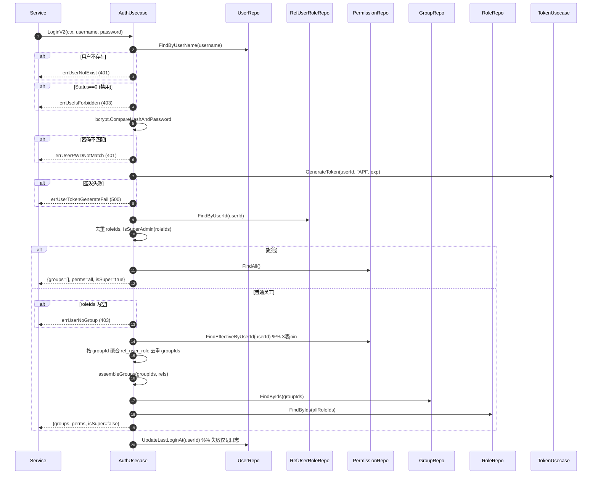

# WWUC v2 Biz 层开发详细文档

> **版本**: v1.0.0
> **作者**: 后端架构
> **日期**: 2026-08-07
> **范围**: `internal/biz/v2` 业务用例层的完整设计与实现说明
> **依赖**: kratos v2 / wire / gorm / bcrypt / google/uuid
> **定位**: biz 层是 DDD 分层架构的"领域服务层",承接 service 层的 proto 请求,编排 repo 仓储完成业务逻辑,返回原生 Go 结构体(非 proto)

---

## 目录

- [第一章 架构总览](#第一章-架构总览)
  - [1.1 分层定位](#11-分层定位)
  - [1.2 依赖注入(Wire)](#12-依赖注入wire)
  - [1.3 文件清单与职责](#13-文件清单与职责)
- [第二章 错误码体系(errcode.go)](#第二章-错误码体系errcodego)
- [第三章 领域模型与仓储契约](#第三章-领域模型与仓储契约)
  - [3.1 User 用户域](#31-user-用户域)
  - [3.2 Group 租户企业域](#32-group-租户企业域)
  - [3.3 Role 角色域](#33-role-角色域)
  - [3.4 Permission 权限/菜单域](#34-permission-权限菜单域)
  - [3.5 RefUserGroup 用户-企业关系](#35-refusergroup-用户-企业关系)
  - [3.6 App 产品域](#36-app-产品域)
  - [3.7 SystemConfig 系统配置域](#37-systemconfig-系统配置域)
- [第四章 业务用例详解](#第四章-业务用例详解)
  - [4.1 AuthUsecase 登录与总览](#41-authusecase-登录与总览)
  - [4.2 UserUsecase 超管-用户管理](#42-userusecase-超管-用户管理)
  - [4.3 GroupUsecase 租户企业管理](#43-groupusecase-租户企业管理)
  - [4.4 RoleUsecase 角色与员工关系管理](#44-roleusecase-角色与员工关系管理)
  - [4.5 MenuUsecase 菜单管理](#45-menuusecase-菜单管理)
  - [4.6 SystemUsecase 系统配置与产品](#46-systemusecase-系统配置与产品)
- [第五章 核心业务规则](#第五章-核心业务规则)
  - [5.1 权限继承模型](#51-权限继承模型)
  - [5.2 超管判定与超管分支](#52-超管判定与超管分支)
  - [5.3 软删与唯一约束](#53-软删与唯一约束)
  - [5.4 事务边界约定](#54-事务边界约定)
- [第六章 密码工具(password.go)](#第六章-密码工具passwordgo)
- [第七章 开发约束与最佳实践](#第七章-开发约束与最佳实践)
- [第八章 已知问题与演进路线](#第八章-已知问题与演进路线)

---

## 第一章 架构总览

### 1.1 分层定位

WWUC v2 严格遵循 **Data → Biz → Service → Wire/Server** 分层架构,biz 层在其中承担"领域服务"角色:

```
┌─────────────────────────────────────────────────────┐
│  Server (HTTP/gRPC)                                 │
│    - 路由 / 中间件 / v2 跳过 v1 鉴权中间件           │
└─────────────────────────────────────────────────────┘
                          ↓ proto
┌─────────────────────────────────────────────────────┐
│  Service (internal/service/v2)                      │
│    - proto ↔ biz 结构体转换 (convert.go)            │
│    - 参数校验 / 返回封装                             │
└─────────────────────────────────────────────────────┘
                          ↓ 原生 Go struct
┌─────────────────────────────────────────────────────┐
│  Biz (internal/biz/v2)        ← 本文档范围          │
│    - 业务用例编排 (Usecase)                          │
│    - 事务边界管理 (common.Transaction)               │
│    - 领域错误映射 (errcode.go)                       │
│    - 仓储接口契约 (Repo interface)                  │
└─────────────────────────────────────────────────────┘
                          ↓ interface
┌─────────────────────────────────────────────────────┐
│  Data (internal/data/v2)                            │
│    - 仓储实现 (GORM / Redis)                         │
│    - mapper tag ↔ schema struct 转换                 │
└─────────────────────────────────────────────────────┘
```

**关键约定**:

1. biz 层**只定义仓储接口**(Repo interface),不依赖具体 ORM;实现由 data 层提供。
2. biz 层返回**原生 Go 结构体**(如 `*User`、`*LoginResult`),不返回 proto message;proto 转换由 service 层负责。
3. 业务错误统一以 **kratos error** 形式返回(`ke.Error`),由 service 层的 HTTP ErrorEncoder 直接转 HTTP 状态码写出。

### 1.2 依赖注入(Wire)

[biz.go](file:///Users/zzj/go/src/wwuc/internal/biz/v2/biz.go) 定义了 v2 biz 层的 Wire ProviderSet:

```go
var ProviderSet = wire.NewSet(
    NewAuthUsecase,
    NewGroupUsecase,
    NewRoleUsecase,
    NewMenuUsecase,
    NewUserUsecase,
    NewSystemUsecase,
)
```

> **注意**: v2 的 ProviderSet 嵌套在 v1 的 `biz/biz.go`、`data/data.go`、`service/service.go` 中,通过 wire 组合生成统一的注入图。新增 Usecase 时需在此处注册。

### 1.3 文件清单与职责

| 文件 | 职责 | 核心导出 |
|------|------|----------|
| [biz.go](file:///Users/zzj/go/src/wwuc/internal/biz/v2/biz.go) | Wire ProviderSet 注册 | `ProviderSet` |
| [errcode.go](file:///Users/zzj/go/src/wwuc/internal/biz/v2/errcode.go) | 业务错误 → HTTP 状态码映射 | `httpErr`, 各 `err*` 变量 |
| [auth.go](file:///Users/zzj/go/src/wwuc/internal/biz/v2/auth.go) | 登录、总览、租户归属校验 | `AuthUsecase`, `LoginResult`, `GroupGroup` |
| [user.go](file:///Users/zzj/go/src/wwuc/internal/biz/v2/user.go) | 超管-用户管理(建用户/重置密码/禁用) | `UserUsecase`, `User`, `UserRepo` |
| [group.go](file:///Users/zzj/go/src/wwuc/internal/biz/v2/group.go) | 租户企业 CRUD + 企业权限范围 | `GroupUsecase`, `Group`, `RefGroupPermission` |
| [role.go](file:///Users/zzj/go/src/wwuc/internal/biz/v2/role.go) | 角色 CRUD + 员工-角色关系 | `RoleUsecase`, `Role`, `RefUserRole`, `RefRolePermission` |
| [permission.go](file:///Users/zzj/go/src/wwuc/internal/biz/v2/permission.go) | 权限/菜单领域模型与仓储契约 | `Permission`, `PermissionRepo` |
| [menu.go](file:///Users/zzj/go/src/wwuc/internal/biz/v2/menu.go) | 菜单节点 CRUD + 树构建 | `MenuUsecase` |
| [ref_user_group.go](file:///Users/zzj/go/src/wwuc/internal/biz/v2/ref_user_group.go) | 用户-企业成员关系仓储契约 | `RefUserGroup`, `RefUserGroupRepo` |
| [app.go](file:///Users/zzj/go/src/wwuc/internal/biz/v2/app.go) | 产品(app)领域模型 | `App`, `AppRepo`, `AppCondition` |
| [system.go](file:///Users/zzj/go/src/wwuc/internal/biz/v2/system.go) | 系统配置 + 产品管理 | `SystemUsecase`, `SystemConfig` |
| [password.go](file:///Users/zzj/go/src/wwuc/internal/biz/v2/password.go) | 密码规则校验与随机生成 | `ValidatePassword`, `GenerateRandomPassword` |

---

## 第二章 错误码体系(errcode.go)

### 2.1 设计动机

v2 接口的 proto 响应体**没有** `Code/Message` 包裹字段,因此业务错误以 kratos error 形式返回。kratos 的 `Error.Code` 会被 HTTP ErrorEncoder 直接作为 HTTP 状态码写出。

而 `api/errors/user_v2.go` 中定义的业务码为 `15000+`(非合法 HTTP 状态码),因此需要一个映射层:

```go
func httpErr(status int, biz *ke.Error) *ke.Error {
    return ke.New(status, biz.Reason, biz.Message)
}
```

`httpErr` 复用 `api/errors` 中定义的业务错误描述(Reason + Message),但把 Code 替换为合法的 HTTP 状态码。

### 2.2 错误码映射表

| 错误变量 | HTTP 状态码 | 业务 Reason | 触发场景 |
|----------|-------------|-------------|----------|
| `errUserNotExist` | 401 | `UserNotExist` | 登录时用户不存在 |
| `errUserPWDNotMatch` | 401 | `UserPWDNotMatch` | 登录密码不匹配 |
| `errUseIsForbidden` | 403 | `UseIsForbidden` | 用户被禁用 (status=0) |
| `errUserNoGroup` | 403 | `UserNoGroup` | 普通员工无任何角色绑定(未关联企业) |
| `errUserTokenGenerateFail` | 500 | `UserTokenGenerateFail` | JWT 签发失败 |
| `errGroupNotFound` | 404 | `GroupNotFound` | 企业不存在 |
| `errGroupNameExists` | 409 | `GroupNameExists` | 企业名称重复 |
| `errGroupCodeExists` | 409 | `GroupCodeExists` | 企业编码重复 |
| `errRoleNameExists` | 409 | `RoleNameExists` | 角色名重复 |
| `errRoleSystemCannotEdit` | 403 | `RoleSystemCannotEdit` | 系统角色(System=1)被改名或重绑权限 |
| `errRoleNotFound` | 404 | `RoleNotFound` | 角色不存在 |
| `errRoleInUse` | 409 | `RoleInUse` | 删除角色时仍有员工绑定 |
| `errPermissionNotFound` | 404 | `PermissionNotFound` | 权限节点不存在 |
| `errPermissionOutOfScope` | 403 | `PermissionOutOfScope` | 角色权限超出企业 scope |
| `errMenuNotFound` | 404 | `MenuNotFound` | 菜单不存在 |
| `errMenuHasChildren` | 409 | `MenuHasChildren` | 删除菜单时有子节点 |
| `errAppNotFound` | 404 | `AppNotFound` | 产品不存在 |
| `errSystemConfigNotFound` | 404 | `SystemConfigNotFound` | 系统配置项不存在 |
| `errUserAlreadyInGroup` | 409 | `UserAlreadyInGroup` | 员工已加入该企业 |
| `errUserNotInGroup` | 404 | `UserNotInGroup` | 员工未加入该企业 |
| `errRoleNotInGroup` | 403 | `RoleNotInGroup` | 角色不属于该企业 |
| `errUserNotFound` | 404 | `UserNotExist` | 用户不存在(管理场景) |
| `errParamsInvalid` | 422 | `ParamsInvalid` | 参数非法 |
| `errUserDuplicate` | 409 | `UserDuplicate` | 用户名重复 |
| `errPwdRuleInvalid` | 422 | `PasswordRuleInvalid` | 生成的密码不满足规则 |
| `errInternalError` | 500 | `INTERNAL_ERROR` | 兜底内部错误 |

### 2.3 使用规范

- **业务错误** 必须使用上表中的预定义变量,禁止在 biz 层直接 `fmt.Errorf` 或 `errors.New`。
- **基础设施错误** (DB/Redis 故障)统一映射为 `errInternalError`,但要先 `uc.log.WithContext(ctx).Errorf(...)` 记录原始错误。
- **scope 校验** 必须放在事务外,避免 403 被事务回滚遮蔽为 500(见 [4.4 CreateRole](#441-createrole))。

---

## 第三章 领域模型与仓储契约

### 3.1 User 用户域

[user.go](file:///Users/zzj/go/src/wwuc/internal/biz/v2/user.go) 定义系统用户。v2 复用 v1 的 `user` 表,但**不读写 App 字段**(v2 用户均为全平台用户,`is_all=1`)。

```go
type User struct {
    Id              *int64     `mapper:"id"`
    Username        string     `mapper:"username"`
    Password        string     `mapper:"password"`     // bcrypt 哈希
    Nickname        string     `mapper:"nickname"`
    CreatedAt       time.Time  `mapper:"createdAt"`
    CreatedBy       int64      `mapper:"createdBy"`
    UpdatedAt       *time.Time `mapper:"updatedAt"`
    UpdatedBy       int64      `mapper:"updatedBy"`
    LastLoginAt     *time.Time `mapper:"lastLoginAt"`
    DeletedUniqueId int64      `mapper:"uniqueDeletedKey"`
    DeletedAt       *time.Time `mapper:"deletedAt"`
    Provider        string     `mapper:"provider"`     // 固定 "wuwen"
    App             int64      `mapper:"app"`
    Status          int64      `mapper:"status"`       // 0=禁用 1=启用
    IsAll           int64      `mapper:"isAll"`        // v2 固定 1
    Remarks         string     `mapper:"remarks"`
}
```

**UserRepo 仓储契约**:

| 方法 | 用途 |
|------|------|
| `FindByUserName` | 登录时按用户名查 |
| `FindById` / `FindByIds` | 按 ID 查(单/批量) |
| `Create` | 建用户 |
| `UpdatePassword` | 重置密码 |
| `Forbidden` | 禁用/启用 (status 翻转) |
| `UpdateInfo` | 更新昵称/状态/备注 |
| `FindByPage` | 分页列表(支持跨企业搜索) |
| `FindByGroupId` | 查某企业下用户(JOIN ref_user_role) |
| `UpdateLastLoginAt` | 登录后更新最后登录时间 |

**UserCondition 分页条件**:

| 字段 | 含义 |
|------|------|
| `GroupId *int64` | nil=跨企业搜索 |
| `GroupName *string` | 关联企业名称模糊 |
| `Username *string` | 用户名模糊 |
| `Nickname *string` | 姓名模糊 |
| `Status *int32` | 0=禁用 1=启用 |

### 3.2 Group 租户企业域

[group.go](file:///Users/zzj/go/src/wwuc/internal/biz/v2/group.go) 定义租户企业。v2 复用 v1 的 `group` 表,但**不读写 managers/app 字段**。

```go
type Group struct {
    Id              *int64     `mapper:"id"`
    System          int8       `mapper:"system"`        // 创建时强制 1
    Name            string     `mapper:"groupName"`
    GroupCode       string     `mapper:"groupCode"`
    GroupCreatedAt  *time.Time `mapper:"groupCreatedAt"` // 创建时 time.Now()
    Status          int8       `mapper:"status"`         // 创建时强制 1
    Remarks         string     `mapper:"remarks"`
    // ... 审计字段
}
```

**GroupRepo 仓储契约**:`Create` / `Update` / `Delete`(软删) / `FindById` / `FindByIds` / `FindByPage` / `ExistsByName` / `ExistsByCode`。

#### RefGroupPermission 企业权限范围

```go
type RefGroupPermission struct {
    Id              *int64
    GroupId         int64
    PermissionId    int64      // 该企业可见的权限 id
    // ... 审计字段
}
```

**RefGroupPermissionRepo 仓储契约**:

| 方法 | 用途 |
|------|------|
| `FindByGroupId` / `FindByGroupIds` | 查企业权限范围(单/批量) |
| `Create` | 新增一条企业-权限绑定 |
| `DeleteByGroupIdAndPermissionId` | 软删指定绑定 |
| `CascadeDeleteRolePermissions` | **级联软删**越界的 `ref_role_permission` 记录(企业 scope 收缩时) |

> **关键设计**: `CascadeDeleteRolePermissions` 是权限继承模型的核心维护点。当企业 scope 收缩时,角色-权限关联中超出新 scope 的记录必须被级联软删,否则会出现"企业已收回权限但角色仍持有"的脏数据。

### 3.3 Role 角色域

[role.go](file:///Users/zzj/go/src/wwuc/internal/biz/v2/role.go) 定义角色与三类关系表。

```go
const roleAdminId int64 = 1  // 超管角色 id 硬编码,Role.Id==1 即超管

type Role struct {
    Id              *int64
    Name            string
    Code            string     // 创建后自动生成: role + YYMMdd + %05d
    Remarks         string
    GroupId         int64      // 角色所属企业
    App             int64
    System          int64      // 1=系统角色(不可改名/不可删/权限固定)
    // ... 审计字段
}
```

**三类关系表**:

| 结构体 | 表 | 含义 |
|--------|----|----|
| `RefUserRole` | `ref_user_role` | 用户-角色-企业 绑定(一个用户在一个企业可绑多角色) |
| `RefRolePermission` | `ref_role_permission` | 角色-权限 绑定(子集) |
| `RefGroupPermission` | `ref_group_permission` | 企业-权限 绑定(父域/企业 scope) |

**RoleRepo 关键方法**:

- `UpdateCode(roleId, code)`: 事务内更新角色 code(用于创建后回填 `role{YYMMdd}{id:05d}`)。
- `ExistsByName(groupId, name)`: 同企业内角色名唯一校验。

### 3.4 Permission 权限/菜单域

[permission.go](file:///Users/zzj/go/src/wwuc/internal/biz/v2/permission.go) 定义权限/菜单节点。v2 复用 v1 的 `permission` 表,但新增了 `menu_type/route_path/icon/sort/app/dependence_children` 字段以支撑菜单树。

```go
type Permission struct {
    Id                 int64
    Domain             string
    Code               int64       // UNIQUE, NOT NULL DEFAULT 0;缺省时自动生成
    Type               uint8       // 1=菜单 2=按钮
    MenuType           *uint8      // 菜单子类型(nil=不改)
    RoutePath          string
    Icon               string
    Sort               int32
    Hidden             *uint8      // 1显示 0隐藏, nil=不改
    App                int64       // 归属产品
    Name               string
    Path               string
    Act                *string
    Description        *string     // nil=不改, 非 nil(含空串)=清空
    DependenceChildren []int64
    DependenceParents  int64       // 父节点 id, 0=根
    // ... 审计字段
}
```

**PermissionRepo 仓储契约**(核心查询方法):

| 方法 | 用途 |
|------|------|
| `FindAll` | 超管登录时拿全部权限 |
| `FindById` / `FindByIds` | 按 ID 查 |
| `FindByRoleIds` | 按角色 id 批量查权限 |
| `FindEffectiveByUserId` | **3 表 join** 查用户有效权限(跨企业) |
| `FindEffectiveByUserIdAndGroupId` | **3 表 join** 查用户在某企业的有效权限 |
| `FindByApp` | 按 app 查权限(全量) |
| `FindByAppAndGroupId` | 按 app + 企业 scope 查权限(JOIN ref_group_permission) |
| `FindAppIdsByGroupIds` | 批量查企业 scope 内的去重 app_id,返回 `groupId -> []app_id` |
| `CountChildren` | 统计子节点数(删菜单前校验) |

> **权限继承 SQL 语义**(3 表 join):
> ```
> ref_user_role ⨝ ref_role_permission ⨝ ref_group_permission
> WHERE user_id = ? AND 各表 deleted_unique_id = 0
> ```
> 有效权限 = 角色权限 ∩ 企业 scope。

### 3.5 RefUserGroup 用户-企业关系

[ref_user_group.go](file:///Users/zzj/go/src/wwuc/internal/biz/v2/ref_user_group.go) 定义用户在某企业的成员关系。

```go
type RefUserGroup struct {
    Id              *int64
    UserId          int64
    GroupId         int64
    Status          int64       // 0=禁用 1=启用
    Remarks         string
    // ... 审计字段
    // 列表展示用快照字段 (由 FindPageByCond 通过 JOIN user/group 填充)
    Username, Nickname, GroupName, GroupCode string
}
```

**关键设计**:
- 一个 `(user_id, group_id)` 在未软删状态下**唯一**,代表员工在某企业的成员关系。
- 其下的多角色通过 `ref_user_role` 表关联(一个 `ref_user_group` 可对应多条 `ref_user_role`)。
- `FindPageByCond` 通过 JOIN user/group 一次性填充快照字段,用于列表展示,避免 N+1 查询。

### 3.6 App 产品域

[app.go](file:///Users/zzj/go/src/wwuc/internal/biz/v2/app.go) 定义产品(app)。

```go
type App struct {
    Id              *int64
    Name            string
    Code            string
    EntryUrl        string
    Icon            string
    Sort            int32
    Status          int8        // 1=启用
    Desc            string
    Detail          string
    Type            string
    // ... 审计字段
}
```

**AppCondition**:`Name *string` / `Code *string` / `Status *int32`。

### 3.7 SystemConfig 系统配置域

[system.go](file:///Users/zzj/go/src/wwuc/internal/biz/v2/system.go) 定义系统配置(key-value)。

```go
type SystemConfig struct {
    Id              *int64
    ConfigKey       string      // 唯一
    ConfigValue     string
    Description     string
    // ... 审计字段
}
```

**SystemConfigRepo**:`GetAll` / `GetByKey` / `Upsert`(批量 upsert)。

---

## 第四章 业务用例详解

### 4.1 AuthUsecase 登录与总览

[auth.go](file:///Users/zzj/go/src/wwuc/internal/biz/v2/auth.go) 承担登录、总览、租户归属校验三大场景。

#### 4.1.1 LoginV2 登录主流程

**事务边界**: 无显式事务。token 持久化是单表 insert,失败即报错;`lastLoginAt` 更新失败不阻塞登录。

**流程**:



**返回结构 LoginResult**:

```go
type LoginResult struct {
    Token        string
    ExpireTime   int64           // unix 秒
    User         *User
    Groups       []*GroupGroup   // 普通员工:按企业聚合的角色;超管:[]
    Permissions  []*Permission   // 超管:全部;普通:有效权限
    IsSuperAdmin bool
}

type GroupGroup struct {
    Group *Group
    Roles []*Role
}
```

**assembleGroups 性能要点**:
- 先批量查所有 group(`FindByIds`),再批量查所有 role(`FindByIds`),避免每个 group 都查一次。
- 企业已被软删时跳过(查不到自然无法进)。
- 每个企业的 roles 为空时返回空切片而非 nil,便于前端渲染。

#### 4.1.2 ListMyApps 总览查我可进的平台

```go
func (uc *AuthUsecase) ListMyApps(ctx, userId, groupId int64, isSuper bool) ([]*App, error)
```

- **超管**: `ar.FindAll()` 返回全部启用平台。
- **普通员工**: `pr.FindEffectiveByUserIdAndGroupId(userId, groupId)` 拿该企业有效权限,从中提取 `p.App` 去重后 `ar.FindByIds(appIds)`。

#### 4.1.3 CheckUserGroupAccess 校验用户租户归属

gRPC 接口,供下游/网关调用。

- 先 `ur.FindById(userId)` 校验用户存在性。
- `rur.FindByUserIdAndGroupId(userId, groupId)` 查绑定。
- 若绑定中存在 `RoleId == roleAdminId`(超管),直接返回 true。
- 否则返回 `len(refs) > 0`。

#### 4.1.4 IsSuperAdminByUserId

通过 userId 反查 `ref_user_role`,聚成 roleIds 后调 `IsSuperAdmin(roleIds)`。供 service 层在 ListMyApps/CheckUserGroupAccess 上下文中使用。

### 4.2 UserUsecase 超管-用户管理

[user.go](file:///Users/zzj/go/src/wwuc/internal/biz/v2/user.go) 的 `UserUsecase` 负责超管维度的用户管理。

#### 4.2.1 CreateUser 创建系统用户

```go
func (uc *UserUsecase) CreateUser(ctx, u *User) (string, error)
```

**返回值**: 自动生成的明文密码(仅供本次回传给前端,后续不再保存明文)。

**流程**:
1. `FindByUserName` 校验用户名唯一 → 重复返回 `errUserDuplicate` (409)。
2. `generateInitialPassword` 生成初始密码(根据 `pwdConf` 配置:固定值或随机)。
3. `ValidatePassword` 校验生成的密码满足规则 → 不满足返回 `errPwdRuleInvalid` (422)。
4. `bcrypt.GenerateFromPassword` 哈希。
5. 默认 `Status=1`、`Provider="wuwen"`、`IsAll=1`(全平台用户)。
6. `ur.Create` 落库 → `gorm.ErrDuplicatedKey` 映射为 `errUserDuplicate`。

#### 4.2.2 ResetPassword 重置密码

返回自动生成的新明文密码。流程:`FindById` → `generateInitialPassword` → `generatePwd` → `UpdatePassword`。

#### 4.2.3 generateInitialPassword 密码生成策略

```go
func (uc *UserUsecase) generateInitialPassword(ctx) (string, error)
```

读取 `*conf.Password` 配置:

| 配置项 | 行为 |
|--------|------|
| `pwdConf.GetRandom() == true` | 调 `GenerateRandomPassword(minLen, maxLen)` 生成随机密码 |
| `pwdConf.GetRandom() == false` | 用 `pwdConf.GetDefault()` 固定密码 |
| `pwdConf == nil` (配置缺失) | 兜底 `"Wuwen2026!"` |

生成后**必须**过 `ValidatePassword` 校验,确保配置的默认值本身满足规则。

#### 4.2.4 其他方法

| 方法 | 说明 |
|------|------|
| `Forbidden(userId, status)` | 禁用/启用用户(status 翻转) |
| `UpdateInfo(userId, operator, nickname, status, remarks)` | 更新用户信息 |
| `FindById` / `FindByPage` | 查询 |
| `UpdateLastLoginAt(userId)` | 登录时调用,**失败仅记日志不阻塞** |

### 4.3 GroupUsecase 租户企业管理

[group.go](file:///Users/zzj/go/src/wwuc/internal/biz/v2/group.go) 的 `GroupUsecase` 负责企业 CRUD 与企业权限范围管理。

#### 4.3.1 CreateGroup 创建企业

```go
func (uc *GroupUsecase) CreateGroup(ctx, t *Group) error
```

- `ExistsByName` 校验名称唯一 → 重复返回 `errGroupNameExists` (409)。
- 若传了 `GroupCode`,`ExistsByCode` 校验编码唯一 → 重复返回 `errGroupCodeExists` (409)。
- 强制 `System=1`、`Status=1`、`GroupCreatedAt=time.Now()`。
- `tr.Create` 落库 → `gorm.ErrDuplicatedKey` 映射为 `errGroupNameExists`。

#### 4.3.2 UpdateGroup 编辑企业

- `FindById` 校验存在性。
- 名称/编码变更时才校验唯一性。
- **proto3 默认值陷阱**: `t.Status == 0` 视为未变更,沿用 `old.Status`,避免 proto3 默认值 0 误停用企业。

#### 4.3.3 SetGroupPermissions 设置企业权限范围(**核心**)

**语义**: 全量覆盖企业 scope(父域)。

```go
func (uc *GroupUsecase) SetGroupPermissions(ctx, userId, groupId int64, permissionIds []int64) error
```

**事务内流程**:

1. `FindById` 校验企业存在性。
2. `rgpr.FindByGroupId` 拿旧 scope。
3. **diff 计算**:
   - `removedIds = 旧scope - 新scope`:需级联软删角色权限。
   - `addedIds = 新scope - 旧scope`:需新增 `ref_group_permission`。
4. `tm.InTx` 事务内:
   - 软删 removed 的 `ref_group_permission`。
   - `rgpr.CascadeDeleteRolePermissions(groupId, removedIds, userId)`:级联软删越界的 `ref_role_permission`。
   - 新增 added 的 `ref_group_permission`。

> **权限继承维护**: 这一步是权限继承模型的"写入侧"。读取侧在 `PermissionRepo.FindEffectiveByUserId`(3 表 join)。企业 scope 收缩时若不级联软删,会出现"企业已收回权限但角色仍持有"的脏数据。

#### 4.3.4 ListGroupApps / ListGroupAppsByGroupIds

从企业 scope 内 `permission.app` 去重推导企业可用产品。语义:**企业拥有某 app 的至少一个菜单权限即视为可用该产品**。

`ListGroupAppsByGroupIds` 批量版本性能要点:
1. 一次 JOIN 查出 `groupId -> []app_id` 映射(去重)。
2. 收集所有 appId 去重后**批量**查 app 表(一次查询)。
3. 按 groupId 装配对应 app 列表(保持 app_id 在 SQL 中的排序)。

### 4.4 RoleUsecase 角色与员工关系管理

[role.go](file:///Users/zzj/go/src/wwuc/internal/biz/v2/role.go) 是 biz 层最复杂的 Usecase,涉及角色 CRUD、权限绑定、员工-角色关系三大块。

#### 4.4.1 CreateRole 创建角色

```go
func (uc *RoleUsecase) CreateRole(ctx, r *Role, permIds []int64) error
```

**事务内流程**:

1. **事务外**:`ExistsByName` 校验同企业内角色名唯一 → 重复返回 `errRoleNameExists` (409)。
2. **事务外**:`dedupPermissionIds` 去重 + `checkPermissionScope` 校验权限 ⊆ 企业 scope → 越界返回 `errPermissionOutOfScope` (403)。
3. **事务内** (`tm.InTx`):
   - `rr.Create(r)` 插入角色,GORM 回填 `r.Id`。
   - 生成 code = `role{YYMMdd}{id:05d}`(如 `role26080700001`)。
   - `rr.UpdateCode(*r.Id, code)` 回填 code。
   - `r.Code = code` 回显。
   - `overwriteRolePermissions` 绑定初始权限(新角色无旧绑定,直接批量插)。

> **scope 校验放事务外的原因**: 避免事务回滚把 403 遮蔽为 500。事务内只处理基础设施错误。

#### 4.4.2 UpdateRole 编辑角色

```go
func (uc *RoleUsecase) UpdateRole(ctx, r *Role, permIds []int64) error
```

**系统角色(System=1)特殊处理**:
- 名称不可改 → 改名返回 `errRoleSystemCannotEdit` (403)。
- 权限固定 → 显式传 permIds 返回 `errRoleSystemCannotEdit`。
- 仅更新 remarks 等非敏感字段,不触碰权限。

**非系统角色**:
- scope 校验 + 事务内更新字段 + **全量覆盖**权限(`overwriteRolePermissions`)。
- `permIds` 为空 = 清空角色所有权限(语义明确)。

#### 4.4.3 DeleteRole 删除角色

- `System==1` 不可删 → `errRoleSystemCannotEdit`。
- `rur.CountByRoleId > 0`(仍有员工绑定)→ `errRoleInUse` (409)。
- 事务内:软删角色 + 软删该角色的 `ref_role_permission` 绑定(避免悬空引用)。

#### 4.4.4 AssignRoleToUser 为企业加员工

```go
func (uc *RoleUsecase) AssignRoleToUser(ctx, userId, groupId int64, roleIds []int64, status int32, remarks string, operatorId int64) error
```

**事务内流程**:
1. 事务外:`rug.Exists(userId, groupId)` 校验重复加入 → 重复返回 `errUserAlreadyInGroup` (409)。
2. 事务外:`checkRolesBelongToGroup` 校验 roleIds 全部属于该企业 → 不属于返回 `errRoleNotInGroup` (403)。
3. `status <= 0` 时默认 `1` 启用。
4. 事务内:
   - 写 `ref_user_group`(status/remarks)。
   - 写多条 `ref_user_role`(roleIds 逐条插入)。

#### 4.4.5 UpdateGroupEmployee 修改企业员工

```go
func (uc *RoleUsecase) UpdateGroupEmployee(ctx, userId, groupId int64, roleIds []int64, status int32, remarks string, operatorId int64) error
```

- 前置:员工必须已加入企业 → 未加入返回 `errUserNotInGroup` (404)。
- `roleIds` **全量覆盖**该用户在该企业的角色绑定(空=清空角色,但不删 `ref_user_group`)。
- 事务内:更新 `ref_user_group`(status+remarks) + 全量覆盖 `ref_user_role`(先软删旧绑定,再批量插新的)。

#### 4.4.6 列表查询方法

| 方法 | 返回 | 用途 |
|------|------|------|
| `ListRolesByGroup` | `[]*Role, total` | 企业下角色分页 |
| `FindGroupsByIds` | `[]*Group` | 角色列表填充 groupName |
| `FindPermissionsByRoleIds` | `map[int64][]*Permission` | 角色列表填充 permissions |
| `ListUsersByGroup` | `users, refs, ugs, total` | 企业下员工列表(含角色+成员关系) |
| `ListGroupEmployees` | `[]*RefUserGroup, total` | 员工-企业关系分页(跨企业搜索) |
| `ListUserRolesByGroup` | `[]*RefUserRole` | 某用户在某企业的角色 |
| `FindUserRolesByGroupId` | `[]*RefUserRole` | 某企业下所有用户的角色绑定 |

#### 4.4.7 辅助函数

```go
// dedupPermissionIds 去重并过滤掉 <=0 的权限 id
func dedupPermissionIds(permIds []int64) []int64

// checkPermissionScope 校验 dedup 必须 ⊆ group_id 的企业 scope
func (uc *RoleUsecase) checkPermissionScope(ctx, groupId int64, dedup []int64) error

// overwriteRolePermissions 全量覆盖角色权限 (软删旧 + 批量插新, 空 dedup=仅删=清空)
// 不含 scope 校验, 调用方须在事务外先校验. 复用 ctx 中的 tx (由调用方 InTx 包裹)
func (uc *RoleUsecase) overwriteRolePermissions(ctx, userId, roleId int64, dedup []int64) error

// IsSuperAdmin 判断角色 id 列表是否含超管 (roleAdminId==1)
func IsSuperAdmin(roleIds []int64) bool
```

### 4.5 MenuUsecase 菜单管理

[menu.go](file:///Users/zzj/go/src/wwuc/internal/biz/v2/menu.go) 复用 `permission` 表(`type=1` 的节点)。

#### 4.5.1 CreateMenu 建菜单节点

```go
func (uc *MenuUsecase) CreateMenu(ctx, p *Permission) error
```

- `p.Type == 0` 时默认 `1`(前端菜单)。
- **code 自动生成**: `permission.code` 有 UNIQUE 约束且 `NOT NULL DEFAULT 0`。v2 API 不暴露 code 字段,因此 `p.Code == 0` 时调 `wuwen.GenerateSonyNum()` 生成唯一值,避免多次建菜单都落到 `code=0` 触发唯一键冲突。

#### 4.5.2 UpdateMenu 编辑菜单

- `FindById` 校验存在性 → 不存在返回 `errMenuNotFound` (404)。
- **保留不可变字段**: `App/Type/Code/Domain` 用旧值覆盖传入值。
- **可空字段语义**:
  - `Hidden == nil`:不改,沿用旧值。
  - `Hidden != nil`:用传入值。
  - `Description == nil`:不改。
  - `Description != nil`(含空串):用传入值(空串=清空)。

#### 4.5.3 DeleteMenu 删除菜单

- `FindById` 校验存在性。
- `CountChildren > 0` → `errMenuHasChildren` (409),禁止删除有子节点的菜单。
- 软删。

#### 4.5.4 ListMenus / GetMenuTree

- `groupId > 0`:按企业 scope 过滤(JOIN `ref_group_permission`)。
- `groupId == 0`:全量。
- `GetMenuTree` 返回 `(roots, children map[int64][]*Permission)`,由 service 层组装树。

### 4.6 SystemUsecase 系统配置与产品

[system.go](file:///Users/zzj/go/src/wwuc/internal/biz/v2/system.go) 负责系统配置(key-value)与产品(app)管理。

| 方法 | 说明 |
|------|------|
| `GetSystemConfig(key)` | key 为空返回全部(map);非空返回单条 |
| `SetSystemConfig(userId, configs)` | 批量 upsert |
| `ListApps` | 产品列表(全量) |
| `ListAppsByPage(cond, offset, limit)` | 产品分页(管理端) |
| `CreateApp(a)` | 创建产品(强制 Status=1) |
| `UpdateApp(a)` | 更新产品(`Id==nil` 返回 `errParamsInvalid`;不存在返回 `errAppNotFound`) |

---

## 第五章 核心业务规则

### 5.1 权限继承模型

v2 的核心设计是**两级权限继承**:

```
企业 scope (父域, ref_group_permission)
    ⊇
角色权限 (子集, ref_role_permission)
    ↓ 用户绑定角色
用户有效权限 = 角色权限 ∩ 企业 scope
```

**读取侧**(3 表 join):

```sql
SELECT DISTINCT p.*
FROM ref_user_role ur
JOIN ref_role_permission rrp ON ur.role_id = rrp.role_id
JOIN ref_group_permission rgp ON ur.group_id = rgp.group_id AND rrp.permission_id = rgp.permission_id
JOIN permission p ON rrp.permission_id = p.id
WHERE ur.user_id = ?
  AND ur.deleted_unique_id = 0
  AND rrp.deleted_unique_id = 0
  AND rgp.deleted_unique_id = 0
  AND p.deleted_unique_id = 0
```

**写入侧维护点**:

| 场景 | 维护动作 |
|------|----------|
| `SetGroupPermissions`(企业 scope 收缩) | `CascadeDeleteRolePermissions` 级联软删越界的 `ref_role_permission` |
| `CreateRole` / `UpdateRole` | `checkPermissionScope` 校验 permIds ⊆ 企业 scope |
| `DeleteRole` | 软删该角色的 `ref_role_permission` |

### 5.2 超管判定与超管分支

```go
const roleAdminId int64 = 1  // 硬编码

func IsSuperAdmin(roleIds []int64) bool {
    for _, id := range roleIds {
        if id == roleAdminId {
            return true
        }
    }
    return false
}
```

**超管在 LoginV2 中的特殊分支**:
- `groups = []*GroupGroup{}`(空,超管不挂企业)。
- `permissions = pr.FindAll()`(全部权限)。
- `isSuperAdmin = true`。

**超管在 ListMyApps 中**:`ar.FindAll()` 返回全部启用平台。

**超管在 CheckUserGroupAccess 中**:若 `ref_user_role` 中存在 `RoleId == roleAdminId`,直接放行,不必挂企业。

### 5.3 软删与唯一约束

v2 全部关系表使用**软删**(`deleted_unique_id` + `deleted_at`):

| 表 | 唯一约束 | 说明 |
|----|----------|------|
| `permission` | `(deleted_unique_id, code)` 即 `idx_del_code` | code 缺省时必须自动生成,否则多次建菜单触发唯一键冲突 |
| `group` | 名称/编码唯一(业务层校验) | |
| `role` | 同企业内角色名唯一 | |
| `ref_user_group` | `(user_id, group_id)` 未软删时唯一 | 重复加入返回 409 |
| `ref_user_role` | 无 DB 唯一约束 | 业务层去重 |

> **测试约束**: 测试生成的 permission code 必须 6 位以上且以 9 开头,避免与生产数据冲突。

### 5.4 事务边界约定

| 场景 | 是否事务 | 说明 |
|------|----------|------|
| `LoginV2` | ❌ | token 持久化单表 insert,失败即报错;lastLoginAt 失败不阻塞 |
| `CreateGroup` | ❌ | 单表 insert |
| `UpdateGroup` | ❌ | 单表 update |
| `SetGroupPermissions` | ✅ | diff + 级联软删 + 新增,必须原子 |
| `CreateRole` | ✅ | insert → 生成 code → update code → 绑权限 |
| `UpdateRole` | ✅ | update + 全量覆盖权限 |
| `DeleteRole` | ✅ | 软删角色 + 软删 ref_role_permission |
| `AssignRoleToUser` | ✅ | 写 ref_user_group + 多条 ref_user_role |
| `UpdateGroupEmployee` | ✅ | 更新 ref_user_group + 全量覆盖 ref_user_role |

**事务使用规范**:

```go
err := uc.tm.InTx(ctx, func(ctx context.Context) error {
    // 事务内逻辑,复用传入的 ctx(包含 tx)
    return nil
})
```

- **scope 校验必须在事务外**,避免 403 被事务回滚遮蔽为 500。
- 事务内只能返回基础设施错误,业务错误在事务外判定。

---

## 第六章 密码工具(password.go)

[password.go](file:///Users/zzj/go/src/wwuc/internal/biz/v2/password.go) 提供密码规则校验与随机生成。

### 6.1 密码规则

- **长度**: 8-32(可配置 `minLen`/`maxLen`)
- **必含**: 数字、大写字母、小写字母、特殊字符(非数字非字母)各至少一个
- **字符集**(排除易混淆字符 `0/O/o/1/l/I`):
  - 数字: `23456789`
  - 大写: `ABCDEFGHJKLMNPQRSTUVWXYZ`
  - 小写: `abcdefghijkmnpqrstuvwxyz`
  - 特殊: `!@#$%^&*()-_=+[]{}`

### 6.2 ValidatePassword

```go
func ValidatePassword(pwd string, minLen, maxLen int) error
```

- `minLen <= 0` 默认 8,`maxLen <= 0` 默认 32。
- 长度不符 → `"password length must be between 8 and 32"`
- 缺四类字符之一 → `"password must contain digit, upper, lower and special char"`

### 6.3 GenerateRandomPassword

```go
func GenerateRandomPassword(minLen, maxLen int) (string, error)
```

- 默认生成 12 位,但不超过 `maxLen`,也不小于 `minLen`(至少 4 位以容纳四类字符)。
- 先各放一个字符保证满足规则,再从全字符集随机填充。
- **Fisher-Yates 打乱**,避免前 4 位固定为各类首字符。
- 使用 `crypto/rand`(密码学安全随机源),**不是** `math/rand`。

---

## 第七章 开发约束与最佳实践

### 7.1 结构体字段类型约定

v2 schema 与 biz 结构体使用**指针风格**字段类型以表达 nullable 语义:

| 场景 | 类型 | 原因 |
|------|------|------|
| 主键 `Id` | `*int64` | 创建时为 nil,GORM 回填后赋值 |
| 时间字段 `CreatedAt` 等 | `*time.Time` | 区分"未设置"与零值 |
| 可空业务字段 `Hidden`/`Description` | `*uint8`/`*string` | 区分"不改"与"清空" |
| 普通字段 `Status`/`Name` | 非指针 | proto3 默认值语义 |

> **强制约束**: schema 和 biz 字段类型**必须对齐**(指针↔非指针会导致 `mapper.convertstructfieldInternal` 的 `reflect.Set` panic)。`common.ConvertData`/`mapper.MapperSlice` 双向依赖此对齐。

### 7.2 mapper tag 规范

每个 biz 结构体字段必须带 `mapper:"xxx"` tag,与 schema 字段名一一对应:

```go
type User struct {
    Id       *int64  `mapper:"id"`
    Username string  `mapper:"username"`
    // ...
}
```

### 7.3 错误处理规范

```go
// ✅ 正确: 业务错误用预定义变量, 基础设施错误先记日志再返回 errInternalError
if err := uc.ur.Create(ctx, u); err != nil {
    uc.log.WithContext(ctx).Errorf("create user failed: %v", err)
    if err == gorm.ErrDuplicatedKey {
        return errUserDuplicate
    }
    return errInternalError
}

// ❌ 错误: 直接返回原始 error
if err := uc.ur.Create(ctx, u); err != nil {
    return err
}
```

### 7.4 日志规范

- 使用 `uc.log.WithContext(ctx)` 保留链路追踪信息。
- 错误日志格式:`{操作描述} failed: %v` 或 `{操作描述} failed, {key}=%v err=%v`。
- `UpdateLastLoginAt` 这类非阻塞操作,失败仅记日志不返回错误。

### 7.5 事务使用规范

```go
// ✅ 正确: scope 校验在事务外
if err := uc.checkPermissionScope(ctx, r.GroupId, dedup); err != nil {
    return err  // 403 直接返回, 不进事务
}
err := uc.tm.InTx(ctx, func(ctx context.Context) error {
    // 事务内只处理基础设施错误
    return uc.rr.Create(ctx, r)
})

// ❌ 错误: scope 校验在事务内, 403 会被回滚遮蔽为 500
err := uc.tm.InTx(ctx, func(ctx context.Context) error {
    if err := uc.checkPermissionScope(ctx, r.GroupId, dedup); err != nil {
        return err  // 事务回滚, 外层统一返回 errInternalError
    }
    return uc.rr.Create(ctx, r)
})
```

### 7.6 性能规范

- **批量查询优先**: 避免循环内查询。`assembleGroups` 一次查所有 group + 一次查所有 role,而非每个 group 查一次。
- **去重再查询**: 收集 id 时先 `map` 去重,减少 IN 条件规模。
- **快照字段填充**: `FindPageByCond` 通过 JOIN 一次性填充 user/group 快照字段,避免 N+1。

### 7.7 v2 接口鉴权约定

v2 接口必须**跳过 v1 鉴权中间件**,通过路由前缀匹配:

```go
strings.HasPrefix("/api.user.v2.")
```

---

## 第八章 已知问题与演进路线

### 8.1 已知问题(LATENT)

以下问题**不在当前用户范围内**,但已识别,待后续修复:

1. **service/v2/convert.go `toGroupInfo` nil panic 风险**:
   `CreatedAt: g.Group.CreatedAt.Unix()` 没有对 `*time.Time` 做 nil 检查,若 `Group.CreatedAt` 为 nil 会 panic。
   (`toGroupGroupInfo` 已修复此问题,`toGroupInfo` 待修。)

2. **schema.RefRolePermission.isDeleted 字段死代码**:
   该字段 unexported + gorm-tagged `is_deleted`,但实际表列是 `deleted_unique_id`。v1/v2 查询都用字符串列名,此字段无效,不要依赖它。

### 8.2 演进路线

| 方向 | 说明 |
|------|------|
| 领域事件解耦 | 当前 GroupScopeChanged 等事件以日志埋点体现,后续可补 Kafka/Nacos 异步通知下游刷新缓存 |
| 超管角色硬编码 | `roleAdminId = 1` 硬编码,未来可考虑配置化或引入 role_type 枚举 |
| `ref_user_role` 无 DB 唯一约束 | 当前靠业务层去重,可考虑加 `(user_id, role_id, group_id, deleted_unique_id)` 唯一索引 |
| `toGroupInfo` nil 修复 | 补 nil 检查,与 `toGroupGroupInfo` 对齐 |

### 8.3 测试约定

- v2 service 测试为**集成测试**,需要真实 DB(`conf/wwuc.yaml`)。
- 测试初始化集中在 `initTestV2Env()`,使用 `sync.Once` 缓存 DB/Redis/transaction/依赖。
- 覆盖率目标 ≥50%(实际达 80.6%),优先覆盖核心逻辑,错误处理路径次之。
- 测试生成的 permission code 必须 6 位以上且以 9 开头。

---

## 附录:数据流速查表

### 登录数据流

```
前端 LoginV2(username, password)
  → service/v2 LoginV2
    → biz/v2 AuthUsecase.LoginV2
      → UserRepo.FindByUserName
      → bcrypt.CompareHashAndPassword
      → TokenUsecase.GenerateToken
      → RefUserRoleRepo.FindByUserId
      → IsSuperAdmin(roleIds)?
        ├─ 是 → PermissionRepo.FindAll
        └─ 否 → PermissionRepo.FindEffectiveByUserId (3表join)
                 → assembleGroups (GroupRepo.FindByIds + RoleRepo.FindByIds)
      → UserUsecase.UpdateLastLoginAt (失败不阻塞)
    ← LoginResult{Token, User, Groups, Permissions, IsSuperAdmin}
  ← proto.LoginV2Reply
```

### 权限继承数据流(读取)

```
用户登录 / 总览
  → PermissionRepo.FindEffectiveByUserId(userId)
    SQL: ref_user_role ⨝ ref_role_permission ⨝ ref_group_permission ⨝ permission
    WHERE user_id=? AND 各表 deleted_unique_id=0
  ← 用户有效权限 = 角色权限 ∩ 企业 scope
```

### 权限继承数据流(写入:企业 scope 收缩)

```
超管 SetGroupPermissions(groupId, newPermIds)
  → GroupUsecase.SetGroupPermissions
    → FindByGroupId (旧 scope)
    → diff: removedIds = 旧scope - 新scope
    → InTx:
        ├─ DeleteByGroupIdAndPermissionId (软删 ref_group_permission)
        ├─ CascadeDeleteRolePermissions (级联软删越界的 ref_role_permission)
        └─ Create (新增 added 的 ref_group_permission)
```

---

> **文档维护**: 本文档随 `internal/biz/v2` 代码同步更新。新增 Usecase/Repo 方法时,请同步更新对应章节与数据流速查表。
