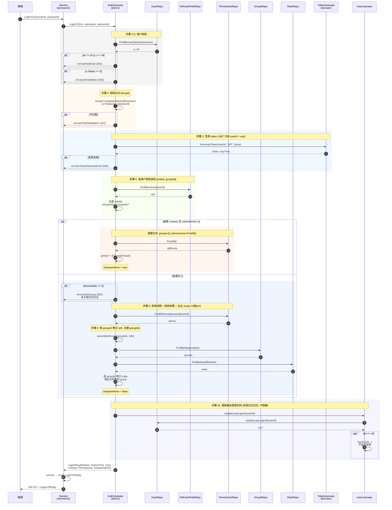
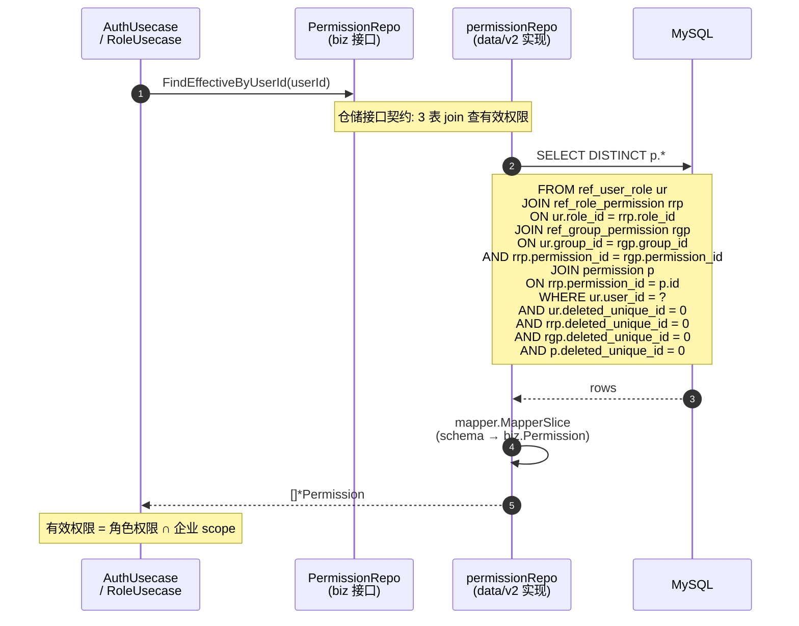
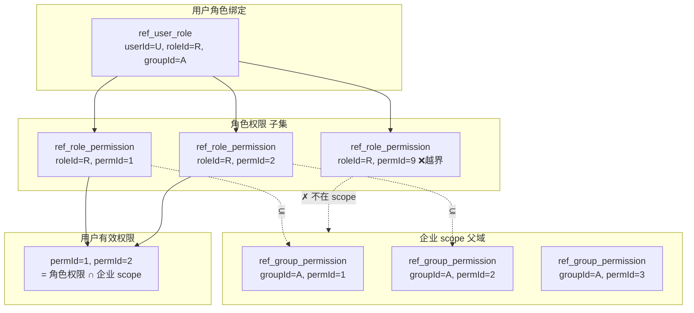
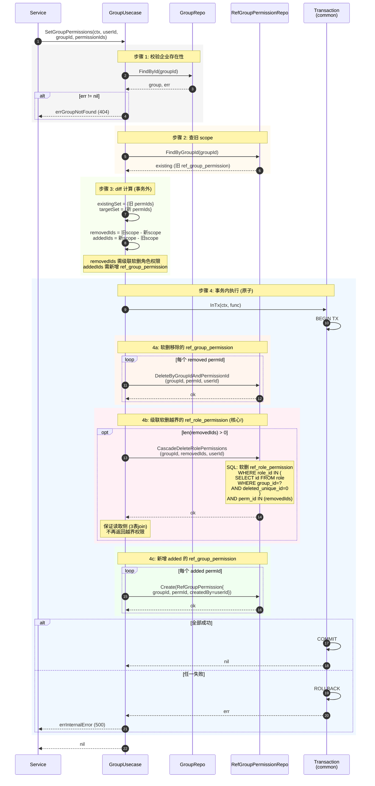
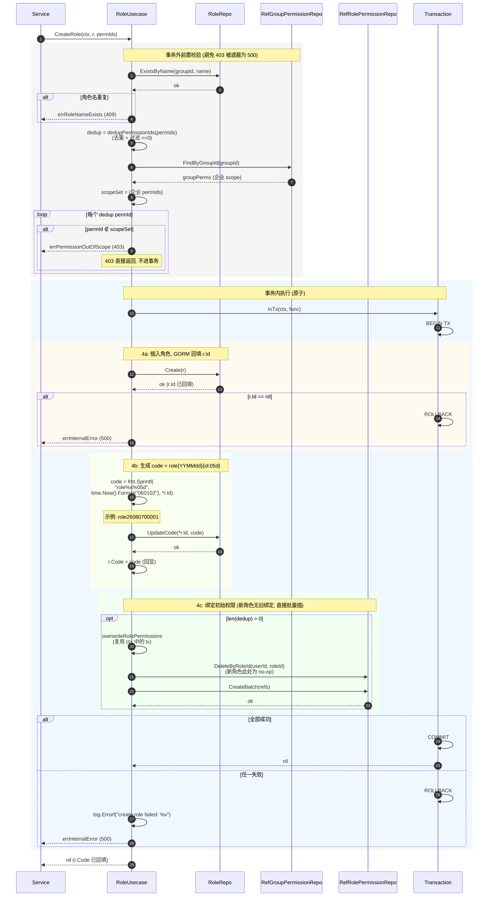
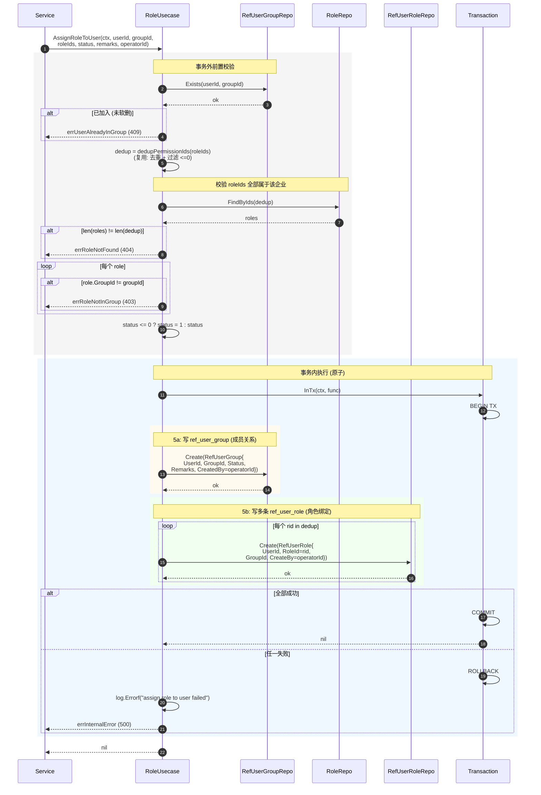
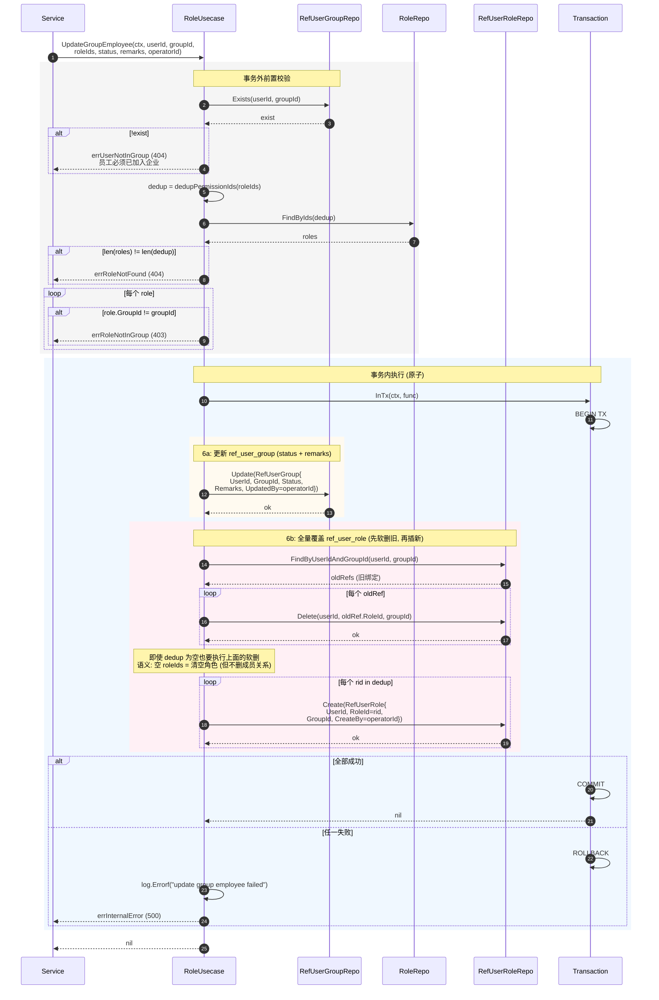

# WWUC v2 核心业务流程时序图

> **版本**: v1.0.0
> **日期**: 2026-08-07
> **配套文档**: [biz-v2-开发文档.md](file:///Users/zzj/go/src/wwuc/docs/biz-v2-开发文档.md)
> **范围**: 选取 v2 biz 层最能体现业务复杂度的 6 个核心流程,以 Mermaid 时序图呈现
> **图例约定**:
>
> - 实线箭头 `→` 表示方法调用
> - 虚线箭头 `-->>` 表示返回
> - `alt`/`opt`/`loop` 为分支/可选/循环
> - 右侧注释 `Note` 标注关键决策点与错误码

***

## 目录

- [流程一:LoginV2 登录主流程](#流程一loginv2-登录主流程)
- [流程二:权限继承读取(3 表 join)](#流程二权限继承读取3-表-join)
- [流程三:SetGroupPermissions 设置企业权限范围](#流程三setgrouppermissions-设置企业权限范围)
- [流程四:CreateRole 创建角色](#流程四createrole-创建角色)
- [流程五:AssignRoleToUser 为企业加员工](#流程五assignroletouser-为企业加员工)
- [流程六:UpdateGroupEmployee 修改企业员工](#流程六updategroupemployee-修改企业员工)
- [附录:核心流程事务边界速查](#附录核心流程事务边界速查)

***

## 流程一:LoginV2 登录主流程

**场景**: 用户输入用户名密码登录,系统校验身份、签发 token、聚合用户在企业中的角色与有效权限。
**事务边界**: 无显式事务。token 持久化是单表 insert;`UpdateLastLoginAt` 失败仅记日志,不阻塞登录。
**核心难点**: 超管分支 + 普通员工的 3 表 join 权限计算 + 按 groupId 聚合角色(避免 N+1)。



**返回结构**:

```go
type LoginResult struct {
    Token        string
    ExpireTime   int64           // unix 秒
    User         *User
    Groups       []*GroupGroup   // 超管:[]; 普通:按企业聚合的角色
    Permissions  []*Permission   // 超管:全部; 普通:有效权限
    IsSuperAdmin bool
}
```

***

## 流程二:权限继承读取(3 表 join)

**场景**: 登录后 / 总览时,查某用户的有效权限。这是权限继承模型的**读取侧**。
**核心 SQL**: `ref_user_role ⨝ ref_role_permission ⨝ ref_group_permission ⨝ permission`
**语义**: 用户有效权限 = 角色权限 ∩ 企业 scope(父域约束子集)



**权限继承模型示意**:



> **写入侧维护**: 当企业 scope 收缩移除 permId=2 时,`SetGroupPermissions` 会级联软删对应的 `ref_role_permission`,保证读取侧不会返回脏数据。详见 [流程三](#流程三setgrouppermissions-设置企业权限范围)。

***

## 流程三:SetGroupPermissions 设置企业权限范围

**场景**: 超管配置某企业的权限范围(父域),采用**全量覆盖**语义。
**事务边界**: ✅ 必须事务。涉及 diff 计算 + 软删移除 + 级联软删越界角色权限 + 新增,必须原子。
**核心难点**: 权限继承模型的**写入侧维护**——企业 scope 收缩时,必须级联软删越界的 `ref_role_permission`。



**diff 计算示例**:

```
旧 scope = {1, 2, 3, 4}
新 scope = {2, 3, 5, 6}
removedIds = {1, 4}   → 软删 ref_group_permission + 级联软删 ref_role_permission
addedIds   = {5, 6}   → 新增 ref_group_permission
```

***

## 流程四:CreateRole 创建角色

**场景**: 超管为某企业创建角色并绑定初始权限。
**事务边界**: ✅ 必须事务。insert → 取 id → 生成 code → update code → 绑权限,必须原子。
**核心规范**: **scope 校验必须在事务外**,避免 403 被事务回滚遮蔽为 500。



**code 生成规则**: `role` + `YYMMdd` + 5 位零填充 id,例如 `role26080700001`。

***

## 流程五:AssignRoleToUser 为企业加员工

**场景**: 超管把某用户加入某企业,并一次绑定多个角色。
**事务边界**: ✅ 必须事务。写 `ref_user_group`(成员关系)+ 写多条 `ref_user_role`(角色绑定),必须原子。
**核心校验**: 重复加入校验 + 角色合法性校验(全部属于该企业)。



**关系表语义**:

```
ref_user_group (成员关系): 一个 (user_id, group_id) 未软删时唯一
    ↓
ref_user_role (角色绑定): 一个 ref_user_group 可对应多条 (多角色)
```

***

## 流程六:UpdateGroupEmployee 修改企业员工

**场景**: 修改某企业员工的角色/状态/备注。角色采用**全量覆盖**语义(空=清空角色,但不删成员关系)。
**事务边界**: ✅ 必须事务。更新 `ref_user_group` + 全量覆盖 `ref_user_role`(先软删旧,再批量插新)。



**与 AssignRoleToUser 的差异**:

| 维度               | AssignRoleToUser | UpdateGroupEmployee |
| ---------------- | ---------------- | ------------------- |
| 前置               | 重复加入返回 409       | 未加入返回 404           |
| ref\_user\_group | Create           | Update              |
| ref\_user\_role  | 直接 Create        | 先软删旧 + 再 Create     |
| 空角色语义            | —                | 清空角色,保留成员关系         |

***

## 附录:核心流程事务边界速查

| 流程                    | 事务 | scope 校验位置          | 核心难点                                 |
| --------------------- | -- | ------------------- | ------------------------------------ |
| LoginV2               | ❌  | —                   | 超管分支 + 3 表 join + 按 group 聚合(避免 N+1) |
| FindEffectiveByUserId | ❌  | —                   | 3 表 join:角色权限 ∩ 企业 scope             |
| SetGroupPermissions   | ✅  | 事务外                 | diff 计算 + 级联软删越界角色权限                 |
| CreateRole            | ✅  | **事务外**(避免 403→500) | insert→生成 code→update code→绑权限       |
| UpdateRole            | ✅  | 事务外                 | 系统角色特殊处理 + 全量覆盖权限                    |
| DeleteRole            | ✅  | —                   | System=1 不可删 + RoleInUse 校验 + 级联软删   |
| AssignRoleToUser      | ✅  | 事务外                 | 重复加入校验 + 角色合法性校验                     |
| UpdateGroupEmployee   | ✅  | 事务外                 | 全量覆盖角色(空=清空) + 保留成员关系                |

> **事务使用铁律**: 所有业务校验(403/404/409)**必须在事务外**完成,事务内只处理基础设施错误。否则业务错误会被事务回滚遮蔽为 500,丢失错误语义。

***

## 附录:Mermaid 渲染说明

本文档所有时序图使用 Mermaid `sequenceDiagram` 语法。在支持 Mermaid 的 Markdown 查看器(VS Code + Mermaid 插件 / GitHub / 飞书文档)中可直接渲染。若需导出为图片,可使用 [mermaid.live](https://mermaid.live) 在线编辑器粘贴渲染。
