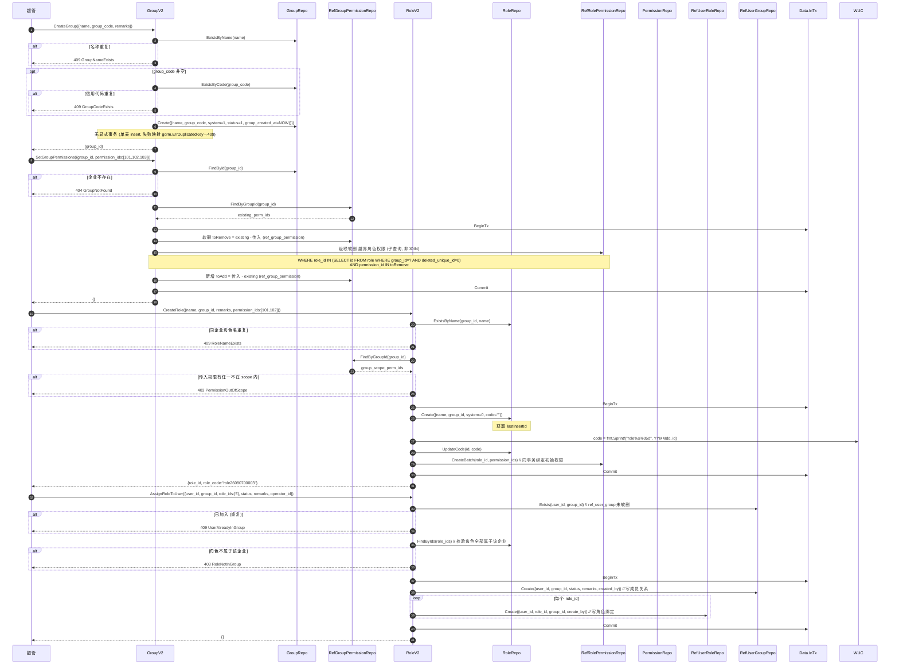
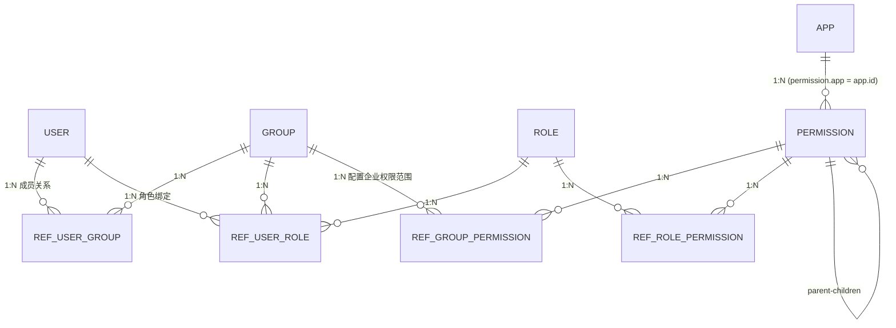

# WWUC 多租户"一账通"详细设计说明书

> **版本**: v1.3.0-implSync (实现校准版)
> **作者**: 后端架构
> **日期**: 2026-08-08
> **范围**: WWUC 服务端新增 v2 接口实现多租户账号体系,不动 v1 老接口
> **修订说明**:
> - v1.2.0: 基于初版修正 5 处设计(① 删除 ref_group_app,企业与产品解耦;② 新增 ref_group_permission;③ 引入权限继承机制;④ Role 新增 code 字段自动生成;⑤ app 表替代 app_registry)。
> - **v1.3.0**: 按 `internal/biz/v2` 实际实现校准。主要修正:① 角色 code 格式由 `role%05d` 改为 `role{YYMMdd}{id:05d}`;② `AssignRoleToUser` 非幂等单角色,实为"加入企业 + 多角色绑定",重复加入返回 409;③ v2 **读写** `ref_user_group`(成员关系),非设计初版所言"不读写";④ `CreateGroup` 无显式事务;⑤ `SetGroupPermissions` 级联软删用子查询而非 JOIN,执行顺序为"软删→级联→新增";⑥ `DeleteRole` 有员工绑定时**阻止删除**(409 RoleInUse);⑦ `ListMyApps` 用 `FindEffectiveByUserIdAndGroupId` 限本企业;⑧ 补齐遗漏接口(UpdateGroupEmployee/ListGroupEmployees/UpdateInfo/ListAppsByPage/ListGroupApps 等)。

---

## 第一章:业务用例与领域事件

### 1.1 业务用例清单

| # | 用例 | 执行角色 | 模块 |
|---|---|---|---|
| UC-01 | 创建系统用户 | 超管 | 用户管理 |
| UC-02 | 重置用户密码 | 超管 | 用户管理 |
| UC-03 | 禁用/启用用户 | 超管 | 用户管理 |
| UC-04 | 创建租户企业 | 超管 | 企业管理 |
| UC-05 | 编辑租户企业 | 超管 | 企业管理 |
| UC-06 | 删除租户企业(软删) | 超管 | 企业管理 |
| UC-07 | 配置企业权限范围 | 超管 | 企业管理 |
| UC-08 | 为企业创建岗位角色 | 超管 | 企业管理 |
| UC-09 | 为角色绑定菜单/按钮权限(向下分配) | 超管 | 企业管理 |
| UC-10 | 为企业添加员工(分配角色) | 超管 | 企业管理 |
| UC-11 | 移除企业员工 | 超管 | 企业管理 |
| UC-12 | 创建/编辑/删除菜单节点 | 超管 | 系统配置 |
| UC-13 | 配置登录页信息 | 超管 | 系统配置 |
| UC-14 | 维护产品(app)注册表 | 超管 | 系统配置 |
| UC-15 | 员工登录(选企业) | 员工/超管 | 登录 |
| UC-16 | 总览查我可进的平台 | 员工/超管 | 总览 |
| UC-17 | 校验用户租户归属 | 下游业务系统/网关 | 鉴权 |

### 1.2 领域事件

| 事件 | 触发时机 | 消费方 |
|---|---|---|
| GroupCreated | UC-04 创建企业后 | 无(预留) |
| GroupScopeChanged | UC-07 企业权限范围变更后 | 无(预留,级联软删越界角色权限在本事务内完成) |
| RoleBoundToUser | UC-10 分配角色后 | 无(预留,登录时查) |
| RoleCodeGenerated | UC-08 创建角色后 | 无(回显用) |
| UserLoginSucceeded | UC-15 登录成功后 | 更新 last_login_at |

> **说明**: 当前不引入消息队列,领域事件以"日志埋点 + 接口直接返回"形式体现。后续若需异步解耦(如企业范围变更通知下游刷新缓存),再补 Kafka/Nacos 布点。

---

## 第二章:核心业务逻辑与流程

### 2.1 接口清单

| 模块 | 接口名称 | 是否需要流程图 | 说明 |
|------|----------|----------------|------|
| AuthV2 | LoginV2 | ✅ | 多表聚合 + 超管分支 + 权限继承计算 |
| AuthV2 | ListMyApps | ❌ | 单表查询,基于登录返回的 permissions 反查 app |
| AuthV2 | CheckUserGroupAccess | ❌ | 单表查询 ref_user_role |
| GroupV2 | CreateGroup | ✅(见 2.2.2) | 唯一性校验 + 事务 |
| GroupV2 | UpdateGroup | ❌ | 单表 update |
| GroupV2 | DeleteGroup | ❌ | 软删,不级联 |
| GroupV2 | GetGroup | ❌ | 单表查询 + 关联展示 |
| GroupV2 | ListGroups | ❌ | 分页查询 |
| GroupV2 | SetGroupPermissions | ✅ | 全量覆盖 diff + 级联软删越界角色权限 + 事务 |
| GroupV2 | ListGroupPermissions | ❌ | 单表查询 |
| GroupV2 | ListGroupApps | ❌ | 查单个企业可用产品(从 scope 内 permission.app 推导) |
| GroupV2 | ListGroupAppsByGroupIds | ❌ | 批量查多企业可用产品(groupId→[]App 映射) |
| RoleV2 | CreateRole | ✅(见 2.2.2) | 编码自动生成(insert→update 同事务) |
| RoleV2 | UpdateRole | ✅ | 编辑角色 + 全量覆盖权限(scope 校验+事务),空=清空 |
| RoleV2 | DeleteRole | ❌ | System=1 不可删;有员工绑定返回 409 RoleInUse;事务内级联软删 ref_role_permission |
| RoleV2 | ListRolesByGroup | ❌ | 分页查询 |
| RoleV2 | AssignRoleToUser | ❌ | 为企业加员工:写 ref_user_group + 多角色 ref_user_role,重复加入返回 409 |
| RoleV2 | UpdateGroupEmployee | ❌ | 修改企业员工:全量覆盖角色 + 更新 status/remarks |
| RoleV2 | RemoveRoleFromUser | ❌ | 软删 ref_user_role |
| RoleV2 | ListUsersByGroup | ❌ | 企业下员工列表(含角色 + 成员关系) |
| RoleV2 | ListGroupEmployees | ❌ | 员工-企业关系分页(支持跨企业搜索) |
| RoleV2 | ListUserRolesByGroup | ❌ | 关联查询 |
| MenuV2 | CreateMenu | ❌ | 单表 insert |
| MenuV2 | UpdateMenu | ❌ | 单表 update |
| MenuV2 | DeleteMenu | ❌ | 有子节点返回 409 MenuHasChildren,否则软删 |
| MenuV2 | ListMenus | ❌ | 按 app 查询,可选按 group_id 过滤 scope |
| MenuV2 | GetMenuTree | ❌ | 按 app 递归建树,可选按 group_id 过滤 scope |
| UserV2 | CreateUser | ❌ | bcrypt + 用户名唯一,返回自动生成的明文密码 |
| UserV2 | ResetPassword | ❌ | bcrypt 重置,返回新明文密码 |
| UserV2 | ListUsers | ❌ | 分页查询(支持跨企业搜索) |
| UserV2 | GetUser | ❌ | 单表查询 |
| UserV2 | ForbiddenUser | ❌ | status 翻转 |
| UserV2 | UpdateInfo | ❌ | 更新用户信息(昵称/状态/备注) |
| SystemV2 | GetSystemConfig | ❌ | 单表查询 |
| SystemV2 | SetSystemConfig | ❌ | Upsert |
| SystemV2 | ListApps | ❌ | 产品列表展示 |
| SystemV2 | ListAppsByPage | ❌ | 产品分页列表(管理端) |
| SystemV2 | CreateApp | ❌ | 单表 insert |
| SystemV2 | UpdateApp | ❌ | 单表 update |

> **统计**: 38 HTTP + 1 gRPC = 39 接口(实现校准后)。其中 5 个需要流程图(LoginV2、SetGroupPermissions、UpdateRole、含于 2.2.2 的 CreateGroup/CreateRole 组合流)。权限绑定已并入 CreateRole/UpdateRole,不再单列 BindPermissionsToRole。员工管理拆为 AssignRoleToUser(加入)/UpdateGroupEmployee(改)/RemoveRoleFromUser(移除单角色)/ListGroupEmployees(关系分页)。

---

### 2.2 复杂接口流程图

#### 2.2.1 LoginV2 登录流程

```mermaid
sequenceDiagram
    autonumber
    participant FE as 前端
    participant WUC as WWUC LoginV2
    participant URepo as UserRepo
    participant TUC as TokenUsecase
    participant RUR as RefUserRoleRepo
    participant Perm as PermissionRepo
    participant GR as GroupRepo
    participant RR as RoleRepo

    FE->>WUC: POST /v2/auth/login {username,password}
    WUC->>URepo: FindByUserName(username)
    alt 用户不存在
        WUC-->>FE: 401 UserNotExist
    end
    alt Status==0 (禁用)
        WUC-->>FE: 403 UseIsForbidden
    end
    WUC->>WUC: bcrypt.CompareHashAndPassword(password)
    alt 密码错
        WUC-->>FE: 401 UserPWDNotMatch
    end
    WUC->>TUC: GenerateToken(userId, "API", &exp)
    TUC-->>WUC: token, expTime
    WUC->>RUR: FindByUserId(userId)
    RUR-->>WUC: [{roleId, groupId}]
    WUC->>WUC: 去重 roleIds; IsSuperAdmin(roleIds)?
    alt 超管分支 (roleIds 含 Role.Id==1)
        WUC->>Perm: FindAll()
        Perm-->>WUC: 全量权限
        Note over WUC: isSuperAdmin=true<br/>groups=[]<br/>permissions=全量
    else 普通员工分支
        opt 无任何角色绑定 (len(roleIds)==0)
            WUC-->>FE: 403 UserNoGroup
        end
        WUC->>Perm: FindEffectiveByUserId(userId)
        Note over Perm: 3表join: ref_user_role ⨝ ref_role_permission ⨝ ref_group_permission<br/>取 role_perms ∩ group_scope
        Perm-->>WUC: 有效权限(扁平列表)
        WUC->>WUC: 按 groupId 聚合 refs 去重 groupIds
        WUC->>GR: FindByIds(groupIds)
        GR-->>WUC: 企业信息
        WUC->>RR: FindByIds(allRoleIds)  %% 批量查角色, 避免每组都查
        RR-->>WUC: 角色信息
        WUC->>WUC: assembleGroups: 按 groupId 聚合 roles, 组装 groups + permissions
    end
    WUC-->>FE: {token, user_info, groups, permissions, is_super_admin}
    WUC->>URepo: UpdateLastLoginAt(userId)  %% 失败仅记日志, 不阻塞
```

**流程说明(对应上图编号):**

1. **接收登录请求**: AuthV2 service 层接收,validate proto 已声明 `min_len=1`,username/password 空返回 422 参数错误。
2. **查用户**: biz 层调 `UserRepo.FindByUserName`,**不传 App 参数**(全平台共用一份用户数据)。失败返回 `UserNotExist` (401)。
3. **状态校验**: `user.Status==0` 返回 `UseIsForbidden` (403)。不校验 App 字段。
4. **密码比对**: `bcrypt.CompareHashAndPassword`,失败返回 `UserPWDNotMatch` (401)。无重试计数,跟老逻辑一致。
5. **生成 Token**: 调 `TokenUsecase.GenerateToken`,JWT 只装 `userId` + 过期时间 + 签发时间,不装 groupId/appId/roleId。token 持久化到 `user_token` 表用于吊销。
   - **事务边界**: Token 生成 + 持久化在 `TokenUsecase` 内,单表 insert,失败返回 `UserTokenGenerateFail` (500)。无显式事务。
6. **查用户角色绑定**: 调 `RefUserRoleRepo.FindByUserId(userId)`,拿 `[{roleId, groupId}]` 列表。这是判断"用户属于哪些企业"的核心查询。
7. **超管判定**: 如果 role 列表里含 `Role.Id==1`:
   - `isSuperAdmin=true`
   - `groups=[]`(超管不挂企业)
   - `permissions=` `PermissionRepo.FindAll()` 全量记录
   - **跳过企业 scope 校验**(超管后门)
8. **普通员工分支**(不含 Role.Id==1):
   - 调 `PermissionRepo.FindEffectiveByUserId(userId)` 一次性 3 表 join 查有效权限:
     ```sql
     SELECT DISTINCT p.*
     FROM ref_user_role ur
     JOIN ref_role_permission rp ON rp.role_id = ur.role_id AND rp.deleted_unique_id = 0
     JOIN ref_group_permission gp ON gp.permission_id = rp.permission_id
        AND gp.group_id = ur.group_id AND gp.deleted_unique_id = 0
     JOIN permission p ON p.id = rp.permission_id AND p.deleted_unique_id = 0
     WHERE ur.user_id = ? AND ur.deleted_unique_id = 0
     ```
   - **权限继承计算**: `有效权限 = 角色权限 ∩ 企业 scope`。由于 `CreateRole`/`UpdateRole` 入库时已校验⊆scope,此交集在正常情况下等于角色权限;但若企业 scope 后续被缩减,此交集能自动剔除越界部分,无需依赖级联清理(双保险)。
9. **组装 groups**: 按 groupId 聚合,每个 group 含 `group_id/group_name/group_code/group_created_at/status` + 该用户在该企业的 `roles` 列表(含 `role_id/role_name/role_code/system/group_id`)。
10. **组装 permissions**: 扁平列表,前端按 `app` 和 `dependence_parents` 自行渲染。**不按 app 过滤**(F4=a 全量返回),**不去重**(前端按 `permission.id` 去重)。
11. **更新最后登录时间**: 异步,失败仅记日志不阻塞响应。

- **异常分支**:
  - 用户不存在 → 401 `UserNotExist`
  - 用户被禁用 → 403 `UseIsForbidden`
  - 密码错 → 401 `UserPWDNotMatch`
  - Token 生成失败 → 500 `UserTokenGenerateFail`
  - 普通员工无任何角色绑定 → 403 `UserNoGroup`(未关联任何企业)
- **事务边界**: 整个登录流程**无显式事务**。Token 持久化单表 insert 失败即报错。LastLoginAt 更新失败不影响登录结果。跟老 Login 一致,不引入分布式事务。

---

#### 2.2.2 企业初始化组合流程

涵盖 UC-04 创建企业 → UC-07 配置企业权限范围 → UC-08 创建角色 → UC-09 绑定角色权限 → UC-10 分配员工。前端按顺序调用,5 个接口各自独立,后端不做编排。



**流程说明:**

1. **CreateGroup**:
   - 校验 `name` 在 `deleted_unique_id=0` 范围内唯一(`ExistsByName`),失败 409 `GroupNameExists`。
   - 校验 `group_code` 唯一(允许为空,**仅非空时**校验 `ExistsByCode`),失败 409 `GroupCodeExists`。
   - 写入 `group` 表:`system=1`(用户创建), `status=1`(正常), `group_created_at=NOW()`。
   - **无显式事务**: 单表 insert,失败时 `gorm.ErrDuplicatedKey` 映射为 409。

2. **SetGroupPermissions**(全量覆盖语义):
   - 查企业存在 → 404 `GroupNotFound`。
   - 查该企业已配置的 permission 列表 `existing`。
   - **diff**:
     - `toAdd = 传入 - existing`(新增)
     - `toRemove = existing - 传入`(软删)
   - **事务内三步**(顺序: 软删→级联→新增):
     1. 软删 `ref_group_permission` 中 toRemove
     2. **级联软删** `ref_role_permission` 中越界记录(子查询定位企业,非 JOIN)
     3. 新增 `ref_group_permission` 中 toAdd
   - **级联理由**: 若不级联,后续 `UpdateRole` 的 scope 校验会因残留越界记录而混乱;登录时的交集计算虽能兜底,但角色管理 UI 会展示脏数据。级联软删在一个事务内完成,保持一致性。
   - **幂等性**: 传入列表等于现有列表时,toAdd/toRemove 均为空,事务空跑,返回 200。

3. **CreateRole**(建角色 + 绑定初始权限):
   - 校验 `name` 在同 group 内(`group_id + deleted_unique_id=0`)唯一,失败 409 `RoleNameExists`。
   - **scope 校验**(事务外): `permission_ids` 去重后必须⊆ `group_id` 企业 scope,任一越界 403 `PermissionOutOfScope`。
   - **事务内 insert→update 生成 code→绑权限**:
     1. `INSERT role(name, group_id, system=0, code='')` → 取 `lastInsertId`
     2. `code = fmt.Sprintf("role%s%05d", time.Now().Format("060102"), id)` → 如 2026-08-07 创建 id=3 生成 `role26080700003`
     3. `UPDATE role SET code=? WHERE id=?`
     4. `RefRolePermissionRepo.CreateBatch(role_id, permission_ids)` 绑定初始权限(新角色无旧绑定,空列表跳过)
     5. Commit
   - **code 生成理由**: code 依赖 id,必须先 insert 拿到自增 id 再生成。放在同事务保证原子性,事务失败则 code 不留残桩。
   - **格式**: `role` + `YYMMdd` + 5 位零填充 id,如 `role26080700003`、`role26080700128`。

4. **UpdateRole**(编辑角色 + 全量覆盖权限):
   - 查角色存在 → 404 `RoleNotFound`。
   - **System=1 保护**: 系统角色名称不可改;权限固定,显式传 `permission_ids`(非空)返回 403 `RoleSystemCannotEdit`,空则跳过权限绑定仅更新字段。
   - 名称变更查重 → 409 `RoleNameExists`;保留 `system/group_id/code` 不可变字段。
   - **scope 校验**(事务外): 非系统角色 `permission_ids` 去重后必须⊆ `group_id` 企业 scope,越界 403 `PermissionOutOfScope`。
   - **事务内 update + 全量覆盖**: 软删旧 `ref_role_permission` + 批量插新,一个事务内。`permission_ids` 为空=清空(仅软删)。

5. **AssignRoleToUser**(加入企业 + 多角色绑定,**非幂等**):
   - 事务外先查 `ref_user_group` 是否存在未软删记录(user_id+group_id),已加入返回 **409 `UserAlreadyInGroup`**(非幂等)。
   - 校验 `role_ids` 全部属于该企业(`role.group_id == groupId`),否则 403 `RoleNotInGroup`。
   - `status<=0` 默认置 1(启用)。
   - 事务内:写 `ref_user_group`(成员关系:status/remarks) + 循环写多条 `ref_user_role`(角色绑定)。
   - **关系表语义**: 一个 `(user_id, group_id)` 在 `ref_user_group` 未软删时唯一(成员关系);其下多角色通过 `ref_user_role` 关联(一个成员关系可对应多条角色绑定)。
   - 修改员工用 `UpdateGroupEmployee`(全量覆盖角色 + 更新 status/remarks,空 role_ids=清空角色但保留成员关系)。

- **异常分支**:
  - 企业名重复 → 409 `GroupNameExists`
  - 信用代码重复 → 409 `GroupCodeExists`
  - 企业不存在 → 404 `GroupNotFound`
  - 角色名同企业内重复 → 409 `RoleNameExists`
  - 角色不存在 → 404 `RoleNotFound`
  - 角色仍有员工绑定 → 409 `RoleInUse`(DeleteRole 阻止删除)
  - 权限越界 → 403 `PermissionOutOfScope`
  - System=1 角色不可编辑/删除 → 403 `RoleSystemCannotEdit`
  - 重复加入企业 → 409 `UserAlreadyInGroup`
  - 角色不属于该企业 → 403 `RoleNotInGroup`
  - 员工未加入企业 → 404 `UserNotInGroup`
- **事务边界**: 每个接口独立事务。SetGroupPermissions、CreateRole、UpdateRole 的多表操作各自在 `Data.InTx` 内,隔离级别 READ COMMITTED(MySQL 默认 REPEATABLE READ,本场景无幻读风险)。

---

#### 2.2.3 UpdateRole 编辑角色 + 权限全量覆盖(独立详图)

```mermaid
flowchart TD
    A[接收 role_id + name/remarks + permission_ids] --> B{role 存在?}
    B -- 否 --> R1[404 RoleNotFound]
    B -- 是 --> C{role.System == 1?}
    C -- 是 --> D{name 改 或 permission_ids 非空?}
    D -- 是 --> R2[403 RoleSystemCannotEdit]
    D -- 否 --> E[仅 update name/remarks, 跳过权限]
    C -- 否 --> F{name 变更?}
    F -- 是 --> G{同企业角色名重复?}
    G -- 是 --> R4[409 RoleNameExists]
    G -- 否 --> H[保留 system/group_id/code]
    F -- 否 --> H
    H --> I{permission_ids ⊆ group scope?}
    I -- 否 --> R3[403 PermissionOutOfScope]
    I -- 是 --> J[BeginTx]
    J --> K[update role name/remarks]
    K --> L[软删 ref_role_permission 旧绑定]
    L --> M{permission_ids 空?}
    M -- 是 --> N[仅清空]
    M -- 否 --> O[CreateBatch 新绑定]
    N --> P[Commit]
    O --> P
    P --> Q[返回 {}]
    E --> Q
```

**流程说明:**

1. **角色存在校验**: `RoleRepo.FindById(role_id)`,不存在 404。
2. **System 角色保护**: `role.System==1` 名称不可改;权限固定,显式传 `permission_ids`(非空)→ 403 `RoleSystemCannotEdit`,空则跳过权限绑定仅更新 name/remarks。超管角色(Role.Id==1,System=1)权限由系统初始化脚本写入,前端不展示绑定按钮。
3. **名称查重**: name 变更时校验同企业唯一,重复 409 `RoleNameExists`。
4. **不可变字段**: 保留 `system/group_id/code`,仅更新 `name/remarks`。
5. **scope 校验**(核心,事务外): 非系统角色 `permission_ids` 去重后必须⊆ `role.group_id` 企业 scope,任一不在 scope 内 → 403 `PermissionOutOfScope`。错误响应不附带越界列表(仅返回错误码,前端自行定位)。
6. **全量覆盖**(事务内): 软删旧 `ref_role_permission` + 批量插新,一个事务内,失败回滚。`permission_ids` 为空=清空(仅软删)。
- **并发**: 不引入锁。若两个超管同时编辑同一角色权限,后提交者覆盖先提交者(diff 基于读取时的 existing 快照)。业务可接受(超管操作低频)。

---

#### 2.2.4 SetGroupPermissions 企业权限范围配置(独立详图)

```mermaid
flowchart TD
    A[接收 group_id + permission_ids] --> B{group 存在?}
    B -- 否 --> R1[404 GroupNotFound]
    B -- 是 --> C[查现有 scope: existing = FindByGroupId]
    C --> D[diff: toAdd = 传入 - existing]
    D --> E[diff: toRemove = existing - 传入]
    E --> F{toAdd 为空 且 toRemove 为空?}
    F -- 是 --> M[返回 {} 幂等]
    F -- 否 --> G[BeginTx]
    G --> H[软删 ref_group_permission 中 toRemove]
    H --> J[级联软删 ref_role_permission: role_id IN 子查询<br/>AND permission_id IN toRemove]
    J --> I[新增 ref_group_permission 中 toAdd]
    I --> K[Commit]
    K --> M
```

**流程说明:**

1. 企业存在校验 → 404 `GroupNotFound`。
2. 查现有 scope `existing`。
3. diff 出 `toAdd`(新增)和 `toRemove`(缩减)。
4. 幂等短路:两者皆空时直接返回。
5. **事务内三步**(顺序: 软删→级联→新增):
   - 软删 `ref_group_permission` 的 toRemove
   - **级联软删** `ref_role_permission`:对该 group 下所有角色,软删其 permission_id 在 toRemove 中的记录
   - 新增 `ref_group_permission` 的 toAdd
6. Commit。
- **级联 SQL**(子查询,非 JOIN):
  > **实现说明**: GORM 的 `Updates(map)` 不会把 `.Joins()` 带进 UPDATE 语句,JOIN 产生的别名 `r.group_id` 未知(MySQL Error 1054)。`ref_role_permission` 表本身无 `group_id` 列,必须经 `role` 表定位企业归属,故用子查询。
  ```sql
  UPDATE ref_role_permission
  SET deleted_unique_id = id,
      deleted_at = NOW(),
      updated_by = ?
  WHERE deleted_unique_id = 0
    AND permission_id IN (?, ?, ?)
    AND role_id IN (SELECT id FROM role WHERE group_id = ? AND deleted_unique_id = 0)
  ```
- **事务边界**: 三步在 `Data.InTx` 内,失败整体回滚。隔离级别 READ COMMITTED 足够。
- **并发**: 预估 QPS < 10(超管操作),不引入锁。靠 `deleted_unique_id` 软删避免唯一索引冲突。

---

### 2.3 状态流转:企业员工生命周期

| 当前状态 | 目标状态 | 触发动作 | 执行操作 | 触发角色 |
|---|---|---|---|---|
| (不存在) | UserCreated | CreateUser | insert user 表, password bcrypt | 超管 |
| UserCreated | AssignedToGroup | AssignRoleToUser | insert ref_user_group(成员关系) + ref_user_role(角色绑定,可多角色) | 超管 |
| AssignedToGroup | AssignedToGroup | UpdateGroupEmployee | 全量覆盖 ref_user_role + 更新 ref_user_group(status/remarks) | 超管 |
| AssignedToGroup | AssignedToGroup | 切换企业 | 前端改 header `x-vcs-groupid` | 员工 |
| AssignedToGroup | RemovedFromGroup | RemoveRoleFromUser | 软删 ref_user_role (deleted_unique_id=id) | 超管 |
| RemovedFromGroup | AssignedToGroup | AssignRoleToUser | 重新 insert ref_user_group + ref_user_role(老软删记录不复活,新建记录) | 超管 |
| 任意 | Forbidden | ForbiddenUser | update user.status=0 | 超管 |
| Forbidden | AssignedToGroup | ForbiddenUser(status=1) | update user.status=1 | 超管 |
| Forbidden | (软删) | (无显式删除) | user 表一般不软删,靠 status=0 拦截 | - |

**禁止流转:**
- 已软删的 `ref_user_role` **不能复活**,必须新建记录(新 id)。跟现有软删模式一致。
- `Forbidden` 用户不能登录(`status==0` 拦截),但其在 `ref_user_role` 的记录不清理,启用后自动恢复企业归属。

---

### 2.4 核心规则描述

#### 2.4.1 权限聚合规则(登录时)

```
if isSuperAdmin:
    return PermissionRepo.FindAll()  # 全量
else:
    return PermissionRepo.FindEffectiveByUserId(userId)
    # SQL: ref_user_role ⨝ ref_role_permission ⨝ ref_group_permission
    # 语义: 角色权限 ∩ 企业 scope (双重保险)
```

- **不按 app 过滤**: 返回用户跨所有 app 的所有有效权限,前端按 `permission.app` 字段自行渲染当前选中平台的菜单(F4=a)。
- **不去重**: 同一 app 下挂多个 role 权限可能重复。SQL 用 `DISTINCT p.id` 去重,但若不同 role 给同一 permission 不同上下文(当前 schema 无此场景),前端按 `permission.id` 去重。后端保持简单。
- **含子节点**: `permission.dependence_children` 是 Int64Array,前端拿扁平列表自行建树。

#### 2.4.2 权限继承机制(核心修正)

**两层模型:**

| 层 | 表 | 语义 | 配置者 |
|---|---|---|---|
| 父域(企业最大范围) | `ref_group_permission` | 该企业能看到的全部菜单权限 | 超管(UC-07) |
| 子集(角色实际分配) | `ref_role_permission` | 角色拥有的权限,必须⊆父域 | 超管(UC-09) |

**不变式:** ∀ role ∈ group, ∀ perm ∈ role.permissions ⟹ perm ∈ group.scope

**维护点:**
1. **写入校验**(`CreateRole`/`UpdateRole`): 传入 permission_ids 必须⊆ role.group_id 的 scope,否则 403 `PermissionOutOfScope`。
2. **缩减级联**(`SetGroupPermissions`): scope 缩减时,事务内级联软删所有角色中越界的 `ref_role_permission` 记录。
3. **读取兜底**(`LoginV2`): 有效权限 = 角色权限 ∩ 企业 scope。即使前两点失效(如直接改库),登录仍能兜底过滤。

**UI 联动:**
- 超管配置企业 scope 页: `ListMenus?app=X`(全量菜单树供勾选)
- 超管配置角色权限页: `ListMenus?app=X&group_id=Y`(只返回 Y 的 scope 内菜单供勾选,前端自然无法越界)

#### 2.4.3 "用户可进哪些平台"判定 (ListMyApps)

```
1. if isSuperAdmin:
       return AppRepo.FindAll()  # 超管看所有平台
2. effective_perms = PermissionRepo.FindEffectiveByUserIdAndGroupId(userId, groupId)  # 限本企业, 非跨企业
3. app_ids = distinct(perm.app for perm in effective_perms if perm.app > 0)
4. return AppRepo.FindByIds(app_ids)
```

**说明:**
- `ListMyApps` 签名为 `ListMyApps(ctx, userId, groupId int64, isSuper bool)`,**必须传 groupId**,普通员工查的是"用户在指定企业的有效权限",而非登录时的跨企业全量。这点与 `LoginV2` 内的 `FindEffectiveByUserId`(跨企业)不同。
- 企业↔产品的关联**不再走独立关系表**,而是从 `permission.app` 字段隐式推导。企业拥有某 app 的至少一个菜单权限,即视为可用该产品。

#### 2.4.4 超管识别规则

- **唯一标识**: `Role.Id == 1`(硬编码常量 `roleAdminId = 1`)
- **不挂 group**: 超管的 `ref_user_role.group_id` 可为 0 或不存在的值
- **JWT 不带标记**: 超管身份靠 `LoginV2` 响应的 `is_super_admin` 字段告知前端,JWT 里只有 userId
- **超管权限**: 全量返回所有 permission(F1=a),前端硬编码"Role.Id==1 时业务模块只读"
- **超管看所有 app**: ListMyApps 直接返回 `AppRepo.FindAll()`,不走 scope 过滤

#### 2.4.5 越权校验规则 (F3=a)

- **不校验**: 信任前端传的 `x-vcs-groupid` header
- **下游业务系统**: 直接读 header 过滤数据,不调 WWUC 校验
- **WWUC 自身接口**: v2 接口也不校验 header 里的 groupId 跟 userId 是否匹配
- **风险**: 用户改 header 可访问别的企业数据 → 由前端控制 + 业务系统层面信任
- **CheckUserGroupAccess 接口仍提供**: gRPC 接口,供未来下游按需调用(默认下游不调)

#### 2.4.6 角色编码生成规则

- **格式**: `role` + `YYMMdd` + `%05d`(5 位零填充 id),如 2026-08-07 创建 id=3 → `role26080700003`
  - 实现代码: `fmt.Sprintf("role%s%05d", time.Now().Format("060102"), *r.Id)`
- **生成时机**: `CreateRole` 事务内,insert 拿 id 后立即 update
- **唯一性**: code 由 id 派生,id 唯一故 code 唯一,不额外加唯一索引
- **用途**: 前端页面回显"企业角色编码",只读字段,不可编辑
- **UpdateRole 不可改 code**: code 在 CreateRole 后只读,UpdateRole 接口不接受 code 参数

---

## 第三章:数据库与数据模型设计

### 3.1 实体关系图



> **关系说明**: `ref_user_group`(成员关系)与 `ref_user_role`(角色绑定)分离——一个 `(user_id, group_id)` 在 `ref_user_group` 未软删时唯一代表"员工在某企业的成员关系";其下多角色通过 `ref_user_role` 关联(一个成员关系可对应多条角色绑定)。

**关键变化(对比初版):**
- 删除 `GROUP ||--o{ REF_GROUP_APP` 关系
- 删除 `APP_REGISTRY ||--o{ REF_GROUP_APP` 关系
- 新增 `GROUP ||--o{ REF_GROUP_PERMISSION` 关系
- `APP_REGISTRY` 改名为 `APP`

### 3.2 表结构变更 (DDL)

#### 3.2.1 group 表新增字段

```sql
ALTER TABLE `group`
    ADD COLUMN group_code VARCHAR(50) DEFAULT '' COMMENT '统一社会信用代码/企业代码' AFTER name,
    ADD COLUMN group_created_at DATETIME NULL COMMENT '企业创建时间' AFTER group_code,
    ADD COLUMN status TINYINT DEFAULT 1 COMMENT '企业状态 1=正常 0=停用' AFTER group_created_at;

ALTER TABLE `group`
    ADD UNIQUE KEY uk_group_code (group_code, deleted_unique_id);
```

**老数据迁移 (F5=c):** 新字段加 default,老数据自动填默认值,超管手动维护。`group_code` 默认空字符串,老数据为 '';`group_created_at` 默认 NULL;`status` 默认 1。不加迁移脚本。

#### 3.2.2 permission 表新增字段

```sql
ALTER TABLE permission
    ADD COLUMN menu_type TINYINT NULL COMMENT '菜单类型 1=目录 2=菜单 3=按钮, 仅 type=1 时有效' AFTER type,
    ADD COLUMN route_path VARCHAR(255) DEFAULT '' COMMENT '前端路由路径' AFTER menu_type,
    ADD COLUMN icon VARCHAR(255) DEFAULT '' COMMENT '菜单图标' AFTER route_path,
    ADD COLUMN sort INT DEFAULT 0 COMMENT '排序' AFTER icon,
    ADD COLUMN app BIGINT DEFAULT 0 COMMENT 'App ID 1=sim 2=embodied 3=embodiedGen' AFTER sort,
    ADD COLUMN act VARCHAR(10) NULL COMMENT 'HTTP method' AFTER path;

ALTER TABLE permission
    ADD INDEX idx_app_parent (app, dependence_parents, deleted_unique_id);
```

**注意**: `permission.app` 是企业↔产品关联的隐式桥梁。企业配置 scope 时勾选的 permission 自带 app 字段,ListMyApps 从中 distinct 出 app_ids。

#### 3.2.3 role 表新增字段

```sql
ALTER TABLE role
    ADD COLUMN code VARCHAR(32) DEFAULT '' COMMENT '角色编码 role+YYMMdd+id, 如 role26080700003, 创建后自动生成只读' AFTER name;
```

**说明:**
- code 由后端在 CreateRole 事务内生成,前端只读展示
- 不加唯一索引:code 由 id 派生,id 唯一故 code 天然唯一
- 老数据迁移:老角色 code 默认空字符串,不影响逻辑;若需补码,超管手动跑一次性脚本 `UPDATE role SET code=CONCAT('role', DATE_FORMAT(create_at, '%y%m%d'), LPAD(id, 5, '0')) WHERE code='' AND deleted_unique_id=0`

#### 3.2.4 ref_group_permission 表 (新建,替代 ref_group_app)

```sql
CREATE TABLE ref_group_permission (
    id                BIGINT AUTO_INCREMENT PRIMARY KEY COMMENT 'Unique identifier',
    group_id          BIGINT NOT NULL COMMENT '租户id',
    permission_id     BIGINT NOT NULL COMMENT '菜单权限id',
    created_by        BIGINT NULL COMMENT 'Creator ID',
    created_at        DATETIME DEFAULT CURRENT_TIMESTAMP NOT NULL COMMENT 'Creation timestamp',
    updated_by        BIGINT NULL COMMENT 'Updater ID',
    updated_at        DATETIME DEFAULT CURRENT_TIMESTAMP NOT NULL ON UPDATE CURRENT_TIMESTAMP COMMENT 'Update timestamp',
    deleted_unique_id BIGINT DEFAULT 0 NOT NULL COMMENT 'Deletion flag',
    deleted_at        DATETIME NULL COMMENT 'Deletion timestamp',
    UNIQUE KEY uk_group_perm (group_id, permission_id, deleted_unique_id),
    INDEX idx_group_id (group_id, deleted_unique_id),
    INDEX idx_permission_id (permission_id, deleted_unique_id)
) COMMENT '企业权限范围关系表(父域)' CHARSET = utf8mb4;
```

**索引设计理由:**
- `uk_group_perm`: 防止同一企业重复配置同一权限,联合 `deleted_unique_id` 保证软删后可重新配置
- `idx_group_id`: 按企业查 scope 是高频查询(LoginV2、UpdateRole、SetGroupPermissions)
- `idx_permission_id`: 级联软删时按 permission_id 反查角色权限

#### 3.2.5 app 表 (新建,替代 app_registry)

```sql
CREATE TABLE app (
    id                BIGINT(20) NOT NULL AUTO_INCREMENT COMMENT 'Unique identifier',
    name              VARCHAR(64) NOT NULL COMMENT '显示名',
    code              VARCHAR(32) NOT NULL COMMENT 'app 编号',
    entry_url         VARCHAR(255) NOT NULL COMMENT '入口URL',
    icon              VARCHAR(255) NOT NULL COMMENT '图标',
    sort              INT(11) NOT NULL DEFAULT '0' COMMENT '排序',
    status            TINYINT(4) NOT NULL DEFAULT '1' COMMENT '1=显示 0=隐藏',
    `desc`            TEXT COMMENT '描述&简介',
    detail            JSON DEFAULT NULL,
    type              VARCHAR(20) NOT NULL DEFAULT '' COMMENT '模块性质',
    created_by        BIGINT(20) NOT NULL,
    created_at        DATETIME NOT NULL DEFAULT CURRENT_TIMESTAMP,
    updated_by        BIGINT(20) DEFAULT NULL,
    updated_at        DATETIME NOT NULL DEFAULT CURRENT_TIMESTAMP ON UPDATE CURRENT_TIMESTAMP,
    deleted_unique_id BIGINT(20) NOT NULL DEFAULT '0',
    deleted_at        DATETIME DEFAULT NULL,
    PRIMARY KEY (id),
    KEY uk_app_id (deleted_unique_id) USING BTREE,
    UNIQUE KEY uk_code (code, deleted_unique_id)
) ENGINE=InnoDB AUTO_INCREMENT=11 DEFAULT CHARSET=utf8mb4 COMMENT='产品表';
```

**字段说明:**
| 字段 | 用途 | 列表展示 |
|---|---|---|
| name | 模块名称 | ✅ 模块名称 |
| sort | 排序 | ✅ 排序 |
| icon | 图标 | ✅ 模块icon |
| type | 模块性质 | ✅ 模块性质 |
| `desc` | 描述&简介 | ✅ 模块描述 |
| status | 1=显示 0=隐藏 | ✅ 可见 |
| entry_url | 入口URL | ✅ 跳转链接 |
| code | 编号 | 详情 |
| detail | JSON扩展 | 详情 |
| id | 主键 | 详情 |

**索引说明:**
- `PRIMARY KEY (id)`: 自增主键
- `KEY uk_app_id (deleted_unique_id) USING BTREE`: 普通索引(非唯一),用于按软删标志过滤。**注**: 初版 `UNIQUE KEY uk_app_id (app_id, deleted_unique_id)` 已修正为普通 KEY,因为所有未删行该列均为 0,唯一索引会导致全表只能存一行未删记录
- `UNIQUE KEY uk_code (code, deleted_unique_id)`: code 在未删范围内唯一

#### 3.2.6 system_config 表 (新建)

```sql
CREATE TABLE system_config (
    id                BIGINT AUTO_INCREMENT PRIMARY KEY,
    config_key        VARCHAR(64) NOT NULL COMMENT '配置key',
    config_value      TEXT NULL COMMENT '配置value',
    description       VARCHAR(255) NULL,
    created_by        BIGINT NULL,
    created_at        DATETIME DEFAULT CURRENT_TIMESTAMP NOT NULL,
    updated_by        BIGINT NULL,
    updated_at        DATETIME DEFAULT CURRENT_TIMESTAMP NOT NULL ON UPDATE CURRENT_TIMESTAMP,
    deleted_unique_id BIGINT DEFAULT 0 NOT NULL,
    deleted_at        DATETIME NULL,
    UNIQUE KEY uk_config_key (config_key, deleted_unique_id)
) COMMENT '系统配置表' CHARSET = utf8mb4;
```

### 3.3 不修改的表 (老逻辑保留)

| 表 | 处理方式 |
|---|---|
| user | 不动字段,v2 复用 |
| role | 新增 code 字段(见 3.2.3),其余不动,v2 复用 (Role.App 不读写) |
| ref_user_group | 不动字段,v2 **读写**(成员关系:加入企业/改员工状态备注/关系分页查询)。一个 (user_id, group_id) 未软删时唯一,其下多角色经 ref_user_role 关联 |
| ref_user_role | 不动字段,v2 **读写** (E3=b, 保留 GroupId 列) |
| ref_role_permission | 不动字段,v2 **读写**(作为权限继承子集) |
| casbin_rule | 不动,v2 不用 (新逻辑走 permission 表) |
| user_token | 不动,v2 复用 |
| ~~ref_group_app~~ | **不创建**(修正后删除该设计) |
| ~~app_registry~~ | **不创建**,改用 `app` 表 |

### 3.4 数据生命周期

- **软删模式**: 所有表用 `deleted_unique_id`(0=未删, 非0=已删且=自身id),跟现有模式一致
- **冷热分离**: 暂不做,数据量小(预估 < 10万级)
- **Token 清理**: `user_token` 表不自动清理过期 token,跟老逻辑一致(靠 `FindToken` 查不到即拒)
- **ref_group_permission 清理**: 软删后保留,不物理删除,靠 `deleted_unique_id` 过滤
- **级联软删残留**: `SetGroupPermissions` 级联软删的 `ref_role_permission` 记录保留,不物理删除

---

## 第四章:接口契约 (API Contract)

### 4.1 接口列表 (按模块分组)

#### AuthV2 模块 (`api/user/v2/auth.proto`)

| RPC | Method | URL | 说明 |
|---|---|---|---|
| LoginV2 | POST | /v2/auth/login | 登录,返 token+groups+permissions |
| ListMyApps | GET | /v2/auth/my/apps | 总览查我可进的平台(从 permissions 推导) |
| CheckUserGroupAccess | gRPC | - | 校验用户租户归属(供下游) |

#### GroupV2 模块 (`api/user/v2/group.proto`)

| RPC | Method | URL | 说明 |
|---|---|---|---|
| CreateGroup | POST | /v2/group | 创建企业 |
| UpdateGroup | PUT | /v2/group/{group_id} | 编辑企业 |
| DeleteGroup | DELETE | /v2/group/{group_id} | 删除企业(软删) |
| GetGroup | GET | /v2/group/{group_id} | 企业详情 |
| ListGroups | GET | /v2/group | 企业分页列表 |
| SetGroupPermissions | POST | /v2/group/{group_id}/permissions | 配置企业权限范围(全量覆盖+级联) |
| ListGroupPermissions | GET | /v2/group/{group_id}/permissions | 查企业权限范围 |
| ListGroupApps | GET | /v2/group/{group_id}/apps | 查企业可用产品(从 scope 推导) |

#### RoleV2 模块 (`api/user/v2/role.proto`)

| RPC | Method | URL | 说明 |
|---|---|---|---|
| CreateRole | POST | /v2/role | 建角色(绑企业)+ 绑定初始权限,自动生成 code |
| UpdateRole | PUT | /v2/role/{role_id} | 编辑角色 + 全量覆盖权限(空=清空,scope 校验) |
| DeleteRole | DELETE | /v2/role/{role_id} | 删除角色(System=1 不可删;有员工绑定 409 RoleInUse) |
| ListRolesByGroup | GET | /v2/role?group_id=X | 企业下角色列表 |
| AssignRoleToUser | POST | /v2/role/assign | 为企业加员工(写 ref_user_group + 多角色,重复加入 409) |
| UpdateGroupEmployee | PUT | /v2/role/employee | 修改企业员工(全量覆盖角色 + status/remarks) |
| RemoveRoleFromUser | DELETE | /v2/role/assign | 移除用户单角色(软删 ref_user_role) |
| ListUsersByGroup | GET | /v2/role/users?group_id=X | 企业下员工列表(含角色 + 成员关系) |
| ListGroupEmployees | GET | /v2/role/employees | 员工-企业关系分页(支持跨企业搜索) |
| ListUserRolesByGroup | GET | /v2/role/user?user_id=X&group_id=X | 用户在某企业的角色 |

#### MenuV2 模块 (`api/user/v2/menu.proto`)

| RPC | Method | URL | 说明 |
|---|---|---|---|
| CreateMenu | POST | /v2/menu | 建菜单节点 |
| UpdateMenu | PUT | /v2/menu/{id} | 编辑菜单 |
| DeleteMenu | DELETE | /v2/menu/{id} | 删除菜单 |
| ListMenus | GET | /v2/menu?app=X[&group_id=Y] | 按 app 查菜单(可选按企业 scope 过滤) |
| GetMenuTree | GET | /v2/menu/tree?app=X[&group_id=Y] | 按 app 拿菜单树(可选按 scope 过滤) |

#### UserV2 模块 (`api/user/v2/user.proto`)

| RPC | Method | URL | 说明 |
|---|---|---|---|
| CreateUser | POST | /v2/user | 创建系统用户 |
| ResetPassword | POST | /v2/user/{user_id}/reset_password | 重置密码 |
| ListUsers | GET | /v2/user | 用户名单 |
| GetUser | GET | /v2/user/{user_id} | 用户详情 |
| ForbiddenUser | POST | /v2/user/{user_id}/forbidden | 禁用/启用 |
| UpdateInfo | PUT | /v2/user/{user_id} | 更新用户信息(昵称/状态/备注) |

#### SystemV2 模块 (`api/user/v2/system.proto`)

| RPC | Method | URL | 说明 |
|---|---|---|---|
| GetSystemConfig | GET | /v2/system/config?key=X | 获取登录页配置 |
| SetSystemConfig | POST | /v2/system/config | 设置登录页配置 |
| ListApps | GET | /v2/system/apps | 产品列表 |
| ListAppsByPage | GET | /v2/system/apps/page | 产品分页列表(管理端) |
| CreateApp | POST | /v2/system/apps | 创建产品 |
| UpdateApp | PUT | /v2/system/apps/{app_id} | 更新产品 |

### 4.2 关键接口详细定义

#### 4.2.1 LoginV2

**Request:**
```json
POST /v2/auth/login
Content-Type: application/json

{
  "username": "admin@wuwen.ai",
  "password": "Abc123!@#"
}
```

**校验规则:**
- username: 非空 (min_len=1)
- password: 非空 (复杂度 8-32位+数字+大小写+特殊字符由前端校验,后端只校验非空)

**Response (普通员工成功):**
```json
{
  "token": "eyJhbGciOiJIUzUxMiIs...",
  "expire_time": 1735689600,
  "user_info": {
    "user_id": 1,
    "username": "admin@wuwen.ai",
    "nickname": "超管"
  },
  "groups": [
    {
      "group_id": 2,
      "group_name": "优必选",
      "group_code": "91110108MA01ABC234",
      "group_created_at": 1672531200,
      "status": 1,
      "roles": [
        {"role_id": 5, "role_name": "仿真管理员", "role_code": "role26080700005", "system": 0, "group_id": 2}
      ]
    }
  ],
  "permissions": [
    {
      "id": 101, "name": "场景管理", "type": 1, "menu_type": 2,
      "route_path": "/scene", "icon": "scene", "sort": 1, "app": 1,
      "path": "", "act": "", "code": 101,
      "dependence_children": [1011, 1012], "dependence_parents": 0
    }
  ],
  "is_super_admin": false
}
```

**超管 Response:**
```json
{
  "token": "...",
  "user_info": {"user_id": 1, "username": "admin@wuwen.ai", "nickname": "超管"},
  "groups": [],
  "permissions": ["全量 permission 记录"],
  "is_super_admin": true
}
```

**业务错误码:**

| Code | 含义 |
|---|---|
| 401 | UserNotExist / UserPWDNotMatch |
| 403 | UseIsForbidden / UserNoGroup |
| 500 | UserTokenGenerateFail |

**幂等性:** 不需要,登录每次生成新 token。
**流程图索引:** 详见 2.2.1 节。

#### 4.2.2 ListMyApps

**Request:**
```
GET /v2/auth/my/apps
Authorization: Bearer <token>
```

**Response:**
```json
{
  "apps": [
    {
      "id": 1,
      "name": "仿真平台",
      "code": "simulation",
      "entry_url": "https://sim.wuwen.ai",
      "icon": "sim",
      "sort": 1,
      "status": 1,
      "type": "业务系统",
      "desc": "具身智能仿真训练"
    }
  ]
}
```

**逻辑:** 超管返回 `AppRepo.FindAll()`;普通员工调 `PermissionRepo.FindEffectiveByUserIdAndGroupId(userId, groupId)`(限本企业),从中 distinct `app` 字段反查 app 表。注意此方法与登录时的 `FindEffectiveByUserId`(跨企业)不同,必须传 groupId。

#### 4.2.3 CheckUserGroupAccess (gRPC, 无 HTTP)

**Request:**
```protobuf
message CheckUserGroupAccessRequest {
  int64 user_id = 1;
  int64 group_id = 2;
}
```

**Response:**
```protobuf
message CheckUserGroupAccessReply {
  bool has_access = 1;
}
```

**逻辑:** 查 `ref_user_role` 表,`user_id=X AND group_id=Y AND deleted_unique_id=0` 存在即 true。

#### 4.2.4 SetGroupPermissions (全量覆盖 + 级联)

**Request:**
```json
POST /v2/group/2/permissions
{
  "permission_ids": [101, 102, 103]
}
```

**处理逻辑:**
```
existing = RefGroupPermissionRepo.FindByGroupId(2)  // [101, 104]
toAdd = [102, 103]     // 传入但不在 existing
toRemove = [104]       // existing 但不在传入
事务内:
  软删 ref_group_permission 中 permission_id=104
  新增 ref_group_permission 中 permission_id=102,103
  级联软删 ref_role_permission 中 permission_id=104 且 role.group_id=2 的记录
```

**Response:** `{}` (空)

**流程图索引:** 详见 2.2.4 节。

#### 4.2.5 ListGroupPermissions

**Request:**
```
GET /v2/group/2/permissions
```

**Response:**
```json
{
  "permission_ids": [101, 102, 103]
}
```

**用途:** 超管编辑企业 scope 时回显已勾选的权限。

#### 4.2.6 CreateRole (code 自动生成)

**Request:**
```json
POST /v2/role
{
  "name": "仿真管理员",
  "group_id": 2,
  "remarks": "管理仿真模块"
}
```

**Response:**
```json
{
  "role_id": 5,
  "role_code": "role26080700005"
}
```

**逻辑:** 事务内 insert → 取 lastInsertId → `fmt.Sprintf("role%s%05d", time.Now().Format("060102"), id)` → update code → commit。详见 2.2.2 节。

#### 4.2.7 UpdateRole (编辑角色 + 全量覆盖权限)

**Request:**
```json
PUT /v2/role/5
{
  "name": "运营主管",
  "remarks": "改备注",
  "permission_ids": [101, 102]
}
```

**处理逻辑:**
```
1. role = RoleRepo.FindById(5) → 404 if not found
2. if role.System == 1:
     if name 变更 or permission_ids 非空 → 403 RoleSystemCannotEdit
     else 仅 update name/remarks, 跳过权限绑定
3. if name 变更: ExistsByName 查重 → 409 RoleNameExists
4. 保留 system/group_id/code 不可变字段
5. dedup = 去重(permission_ids)
6. scope = RefGroupPermissionRepo.FindByGroupId(role.group_id)
   if not set(dedup).issubset(scope) → 403 PermissionOutOfScope
7. 事务内: Update role + 软删 ref_role_permission 旧绑定 + (非空则) CreateBatch 新绑定
   permission_ids 为空 = 清空(仅软删)
```

**Response:** `{}` (空)

**业务错误码:**

| Code | 含义 |
|---|---|
| 404 | RoleNotFound |
| 409 | RoleNameExists |
| 403 | RoleSystemCannotEdit / PermissionOutOfScope |

**流程图索引:** 详见 2.2.3 节。

#### 4.2.8 ListMenus (可选 scope 过滤)

**Request:**
```
GET /v2/menu?app=1                       # 全量菜单(超管配置企业 scope 用)
GET /v2/menu?app=1&group_id=2            # 仅返回 group=2 的 scope 内菜单(角色选权限用)
```

**Response:**
```json
{
  "menus": [
    {
      "id": 101, "name": "场景管理", "type": 1, "menu_type": 2,
      "route_path": "/scene", "icon": "scene", "sort": 1, "app": 1,
      "dependence_children": [1011, 1012], "dependence_parents": 0
    }
  ]
}
```

**逻辑:**
- 无 group_id: `SELECT * FROM permission WHERE app=? AND deleted_unique_id=0`
- 有 group_id: `SELECT p.* FROM permission p JOIN ref_group_permission gp ON gp.permission_id=p.id WHERE p.app=? AND gp.group_id=? AND gp.deleted_unique_id=0 AND p.deleted_unique_id=0`

#### 4.2.9 ListApps (产品列表)

**Request:**
```
GET /v2/system/apps
```

**Response:**
```json
{
  "apps": [
    {
      "id": 1,
      "name": "仿真平台",
      "code": "simulation",
      "entry_url": "https://sim.wuwen.ai",
      "icon": "sim",
      "sort": 1,
      "status": 1,
      "type": "业务系统",
      "desc": "具身智能仿真训练"
    }
  ]
}
```

**列表展示字段:** 模块名称(name) / 排序(sort) / 模块icon(icon) / 模块性质(type) / 模块描述(desc) / 可见(status) / 跳转链接(entry_url)。

---

## 第五章:异常处理与边界防御

### 5.1 错误码映射表

v2 接口的 proto 响应体没有 Code/Message 包裹字段,业务错误以 kratos error 形式返回。`api/errors/user_v2.go` 定义业务错误描述(Reason+Message,业务码 15000+),biz 层 `errcode.go` 的 `httpErr(status, biz)` 将其复用到合法 HTTP 状态码:

| 错误变量 | HTTP | 业务 Reason | 含义 |
|---|---|---|---|
| errUserNotExist | 401 | UserNotExist | 登录时用户不存在 |
| errUserPWDNotMatch | 401 | UserPWDNotMatch | 登录密码不匹配 |
| errUseIsForbidden | 403 | UseIsForbidden | 用户被禁用 (status=0) |
| errUserNoGroup | 403 | UserNoGroup | 普通员工无任何角色绑定 |
| errUserTokenGenerateFail | 500 | UserTokenGenerateFail | JWT 签发失败 |
| errGroupNotFound | 404 | GroupNotFound | 企业不存在 |
| errGroupNameExists | 409 | GroupNameExists | 企业名称已存在 |
| errGroupCodeExists | 409 | GroupCodeExists | 企业代码已存在 |
| errRoleNotFound | 404 | RoleNotFound | 角色不存在 |
| errRoleNameExists | 409 | RoleNameExists | 角色名称同企业内已存在 |
| errRoleSystemCannotEdit | 403 | RoleSystemCannotEdit | 系统角色不可编辑/删除 |
| errRoleInUse | 409 | RoleInUse | 删除角色时仍有员工绑定 |
| errPermissionNotFound | 404 | PermissionNotFound | 权限节点不存在 |
| errPermissionOutOfScope | 403 | PermissionOutOfScope | 权限越界(不在企业 scope 内) |
| errMenuNotFound | 404 | MenuNotFound | 菜单不存在 |
| errMenuHasChildren | 409 | MenuHasChildren | 删除菜单时有子节点 |
| errAppNotFound | 404 | AppNotFound | 产品不存在 |
| errSystemConfigNotFound | 404 | SystemConfigNotFound | 系统配置项不存在 |
| errUserAlreadyInGroup | 409 | UserAlreadyInGroup | 员工已加入该企业 |
| errUserNotInGroup | 404 | UserNotInGroup | 员工未加入该企业 |
| errRoleNotInGroup | 403 | RoleNotInGroup | 角色不属于该企业 |
| errUserNotFound | 404 | UserNotExist | 用户不存在(管理场景) |
| errParamsInvalid | 422 | ParamsInvalid | 参数非法 |
| errUserDuplicate | 409 | UserDuplicate | 用户名重复 |
| errPwdRuleInvalid | 422 | PasswordRuleInvalid | 生成的密码不满足规则 |
| errInternalError | 500 | INTERNAL_ERROR | 兜底内部错误 |

### 5.2 边界场景清单

| 场景 | 方案 |
|---|---|
| **并发创建同名企业** | 依赖 `uk_name (name, deleted_unique_id)` 唯一索引,并发时一个成功一个报 409 |
| **并发创建同 group_code** | 依赖 `uk_group_code` 唯一索引 |
| **重复加入企业** | `AssignRoleToUser` 先查 `ref_user_group` 未软删记录,已加入返回 **409 `UserAlreadyInGroup`**(非幂等)。修改员工走 `UpdateGroupEmployee`(全量覆盖角色) |
| **删除角色时仍有用户绑定** | **阻止删除**:`DeleteRole` 调 `CountByRoleId > 0` 返回 **409 `RoleInUse`**。须先移除该角色的所有员工绑定才能删 |
| **删除系统角色** | `System==1` 角色不可删也不可改名/重绑权限,返回 403 `RoleSystemCannotEdit` |
| **删除菜单时有子节点** | **阻止删除**:`DeleteMenu` 调 `CountChildren > 0` 返回 **409 `MenuHasChildren`**。须先删子节点 |
| **删除菜单时仍有角色绑定** | **不阻止删除**,菜单软删后 LoginV2 查 permissions 时自然过滤掉。`ref_role_permission` 残留记录不影响 |
| **删除企业时仍有员工** | **不阻止删除**,企业软删后员工登录时该 group 查不到,自然无法进。不做级联(简化) |
| **企业 scope 缩减后角色权限越界** | `SetGroupPermissions` 事务内级联软删 `ref_role_permission` 中越界记录。登录时再做交集兜底 |
| **角色权限绑定越界** | `CreateRole`/`UpdateRole` 入库前校验⊆scope,越界返回 403 `PermissionOutOfScope` |
| **角色 code 冲突** | code 由 id 派生,不冲突。若老数据 code 为空,可跑一次性脚本补码 |
| **Token 过期** | JWT 自带 `ExpiresAt`,网关解析时拒 |
| **Token 吊销** | `user_token` 表删除记录,网关调 `CheckToken` 时查不到即拒 |
| **超管误删自己** | 不做特殊防护,超管职责自负 |
| **大页面 ListXxx 查询** | 强制分页,`page_size` 上限 100,超过截断 |
| **app 表 deleted_unique_id 索引** | 普通索引(非唯一),多个未删行该列均为 0,不冲突 |

### 5.3 并发竞争策略

**选择乐观锁还是悲观锁? 都不用。**

理由:
- 预估 QPS < 100(超管操作,非高频)
- 所有写操作都是单表或简单的多表 insert/delete
- 唯一性靠数据库唯一索引保证
- 业务上没有"读-改-写"的竞态(scope 和 role_perms 都是全量覆盖,不读旧值)
- `SetGroupPermissions` 和 `UpdateRole` 的 diff 基于"读时快照",并发覆盖由业务接受(超管低频)

**唯一需要并控制的场景**: `SetGroupPermissions` 的"diff + 级联软删"——用事务隔离,不引入锁。隔离级别 READ COMMITTED 足够(无幻读风险,因 WHERE 条件固定)。

**Role code 生成并发**: insert→update 在同事务,MySQL AUTO_INCREMENT 保证 id 唯一,无并发冲突。

---

## 第六章:技术栈与中间件策略

### 6.1 缓存策略

**当前不引入 Redis 缓存。** 理由:
- 数据量小(用户/企业/角色/权限 < 10万级)
- 多租户隔离靠 header + 查询过滤,不靠缓存
- 引入缓存会增加"缓存与数据库一致性"的复杂度(尤其 scope 缩减级联)

**未来预留**: 若 `LoginV2` 的 3 表 join 权限聚合查询成为瓶颈,可加 Redis 缓存:
- Key: `user_perms:{userId}`
- Value: permissions 列表 JSON
- TTL: 5 分钟
- 失效: 用户角色变更 / 企业 scope 变更时主动删 key

### 6.2 消息队列

**不引入。** 领域事件当前仅日志埋点。`SetGroupPermissions` 的级联软删在事务内同步完成,不需要异步。

### 6.3 定时任务

**不引入。** 跟老逻辑一致。

### 6.4 日志埋点

| 节点 | 字段 |
|---|---|
| LoginV2 成功 | userId, username, isSuperAdmin, groupCount, permCount |
| LoginV2 失败 | username, reason |
| AssignRoleToUser | userId, roleId, groupId, operatorId |
| SetGroupPermissions | groupId, toAddCount, toRemoveCount, cascadeCount, operatorId |
| UpdateRole | roleId, groupId, name, toAddCount, toRemoveCount, operatorId |
| CreateRole | roleId, roleCode, groupId, operatorId |
| CreateGroup | groupId, groupName, groupCode, operatorId |

所有日志带 `Request-Id`(中间件已注入)。

---

## 第七章:实现分层结构

### 7.1 目录结构 (新增)

```
api/user/v2/                          # Proto 定义 (已完成,需按修正更新)
├── auth.proto
├── group.proto
├── role.proto
├── menu.proto
├── user.proto
├── system.proto
└── common.proto

api_gen/user/v2/                      # 生成代码 (make api 生成,不手改)
├── *.pb.go
├── *_grpc.pb.go
├── *_http.pb.go
└── *.pb.validate.go

internal/service/v2/                  # Service 层 (新增)
├── auth.go                           # AuthV2Service
├── group.go                         # GroupV2Service
├── role.go                           # RoleV2Service
├── menu.go                           # MenuV2Service
├── user.go                           # UserV2Service
└── system.go                         # SystemV2Service

internal/biz/v2/                      # Biz 层 (新增)
├── biz.go                            # Wire ProviderSet 注册
├── errcode.go                        # 业务错误 → HTTP 状态码映射 (httpErr)
├── auth.go                           # AuthUsecase (LoginV2 + ListMyApps + CheckUserGroupAccess)
├── group.go                          # GroupUsecase (含 SetGroupPermissions 级联 + ListGroupApps)
├── role.go                           # RoleUsecase (含 code 生成 + scope 校验 + 员工关系管理)
├── menu.go                           # MenuUsecase
├── user.go                           # UserUsecase (建用户/重置密码/禁用/UpdateInfo)
├── system.go                         # SystemUsecase (系统配置 + 产品 CRUD)
├── permission.go                     # Permission 领域模型 + PermissionRepo 契约
├── ref_user_group.go                 # RefUserGroup 成员关系 + RefUserGroupRepo 契约
├── app.go                            # App 产品领域模型 + AppRepo 契约
└── password.go                       # 密码规则校验 + 随机生成 (crypto/rand)

internal/data/v2/                     # Data 层 (新增)
├── data.go                           # v2 ProviderSet + 公共数据
├── group.go                          # GroupRepo 实现
├── ref_group_permission.go           # RefGroupPermissionRepo (含 CascadeDeleteRolePermissions 子查询)
├── ref_user_group.go                 # RefUserGroupRepo 实现 (成员关系)
├── app.go                            # AppRepo 实现
├── system_config.go                  # SystemConfigRepo 实现
├── permission.go                     # PermissionRepo (含 FindEffectiveByUserId 3表join)
├── role.go                           # RoleRepo + RefUserRoleRepo + RefRolePermissionRepo 实现
└── user.go                           # UserRepo 实现
```

### 7.2 Wire DI 新增 Provider

在 `cmd/wwuc/wire.go` 新增:

```go
var ProviderSet = wire.NewSet(
    // ... 现有 v1 providers ...
    // v2 新增
    v2Service.NewAuthV2Service,
    v2Service.NewGroupV2Service,
    v2Service.NewRoleV2Service,
    v2Service.NewMenuV2Service,
    v2Service.NewUserV2Service,
    v2Service.NewSystemV2Service,
    v2Biz.NewAuthUsecase,
    v2Biz.NewGroupUsecase,
    v2Biz.NewRoleV2Usecase,
    v2Biz.NewMenuUsecase,
    v2Biz.NewUserV2Usecase,
    v2Biz.NewSystemUsecase,
    v2Data.NewGroupV2Repo,
    v2Data.NewRefGroupPermissionRepo,
    v2Data.NewAppRepo,
    v2Data.NewSystemConfigRepo,
    v2Data.NewPermissionV2Repo,
    v2Data.NewRefUserRoleV2Repo,
    v2Data.NewRoleV2Repo,
    v2Data.NewUserV2Repo,
)
```

### 7.3 HTTP Server 注册

在 `internal/server/http.go` 新增 v2 service 注册:

```go
// 现有 v1
userV1.RegisterUserService(httpSrv, userSvc)
// v2 新增
v2.RegisterAuthV2HTTPServer(httpSrv, authSvc)
v2.RegisterGroupV2HTTPServer(httpSrv, groupSvc)
v2.RegisterRoleV2HTTPServer(httpSrv, roleSvc)
v2.RegisterMenuV2HTTPServer(httpSrv, menuSvc)
v2.RegisterUserV2HTTPServer(httpSrv, userSvc)
v2.RegisterSystemV2HTTPServer(httpSrv, systemSvc)
```

**JWT 中间件白名单新增**: `/v2/auth/login` 加入 `TokenValidationMiddleware` 的白名单(跟老 `/user/login` 一致)。

---

## 第八章:实现顺序与排期

| 顺序 | 任务 | 依赖 |
|---|---|---|
| 1 | Schema 改动 (group/permission/role 加字段, ref_group_permission/app/system_config 新建) | - |
| 2 | Proto 定义 (按修正更新: 删 ref_group_app 相关, 加 SetGroupPermissions/ListGroupPermissions, role 加 code, app 替代 app_registry) | - |
| 3 | `make api` 生成代码 (用户执行) | 2 |
| 4 | DDL 迁移脚本 (用户手动执行 SQL) | 1 |
| 5 | Data 层 repo 实现 (含 FindEffectiveByUserId 3表join, ref_group_permission 级联, role code 生成) | 3 |
| 6 | Biz 层 usecase 实现 (含 scope 校验, 级联软删逻辑) | 5 |
| 7 | Service 层 handler 实现 | 6 |
| 8 | Wire DI 更新 + `make generate` | 7 |
| 9 | HTTP server 注册 v2 路由 | 8 |
| 10 | 中间件白名单更新 | 9 |
| 11 | 单元测试 (重点: LoginV2 权限聚合, SetGroupPermissions 级联, UpdateRole scope 校验+全量覆盖, CreateRole code 生成) | 10 |

---

## 第九章:待确认与风险点

### 9.1 风险点

| 风险 | 影响 | 缓解 |
|---|---|---|
| 越权校验靠前端 (F3=a) | 用户改 header 可越权 | 后续可补网关校验,当前业务可接受 |
| 老数据 group_code 为空 | 唯一索引可能冲突(多个空值) | MySQL 空字符串不参与唯一约束,多个 '' 不冲突 |
| 老数据 role.code 为空 | 列表回显 code 为空 | 跑一次性脚本 `UPDATE role SET code=CONCAT('role',DATE_FORMAT(create_at,'%y%m%d'),LPAD(id,5,'0')) WHERE code=''` |
| 超管权限全量返回 | permission 表很大时 LoginV2 响应慢 | 短期可接受,长期加 Redis 缓存 |
| 删除角色/菜单的级联 | DeleteRole 有员工绑定阻止(409 RoleInUse)+ 事务内级联软删 ref_role_permission;DeleteMenu 有子节点阻止(409 MenuHasChildren)。删除企业不级联(员工登录时自然过滤) | 查询时靠 deleted_unique_id 过滤,不影响逻辑 |
| SetGroupPermissions 级联软删 | 大企业可能涉及多角色批量软删 | 事务内单条 UPDATE 子查询(非JOIN),预估 < 1000 行,可接受 |
| 3 表 join 权限聚合 | LoginV2 查询稍慢 | 数据量小 < 10万级,加索引 idx_group_id + idx_permission_id 覆盖 |

### 9.2 待用户确认

1. **DDL 执行时机**: Schema 改动的 ALTER TABLE 何时执行? 建议在 v2 代码部署前手动跑。
2. **make api 执行**: 用户自行执行 `make api` 生成 api_gen 代码。
3. **v1 接口共存**: v1 和 v2 接口同时存在,老前端调 v1,新前端调 v2,无冲突。
4. **app_registry.go 处理**: 已存在的 `internal/data/schema/app_registry.go` 需删除或重命名为 `app.go`。
5. **ref_group_app.go 处理**: 已存在的 `internal/data/schema/ref_group_app.go` 需删除。

---

## 第十章:接口数量统计与工时评估

### 10.1 接口数量统计

| 模块 | HTTP 接口数 | gRPC 接口数 | 合计 | 复杂度 |
|---|---|---|---|---|
| AuthV2 | 2 (LoginV2, ListMyApps) | 1 (CheckUserGroupAccess) | 3 | 高 |
| GroupV2 | 9 (含 ListGroupApps/ListGroupAppsByGroupIds) | 0 | 9 | 中高(SetGroupPermissions 级联) |
| RoleV2 | 10 (含 UpdateGroupEmployee/ListGroupEmployees) | 0 | 10 | 中高(scope 校验 + code 生成 + 员工关系) |
| MenuV2 | 5 | 0 | 5 | 中 |
| UserV2 | 6 (含 UpdateInfo) | 0 | 6 | 低 |
| SystemV2 | 6 (含 ListAppsByPage) | 0 | 6 | 低 |
| **合计** | **38** | **1** | **39** | - |

> **说明**: AuthV2 数量最少但复杂度最高(LoginV2 涉及 3 表 join 权限聚合 + 超管分支 + 权限继承计算)。GroupV2 和 RoleV2 因引入权限继承机制 + 员工关系管理,复杂度从初版的"中"上调为"中高"。RoleV2 的员工管理拆为 AssignRoleToUser/UpdateGroupEmployee/RemoveRoleFromUser/ListGroupEmployees 四个接口。

### 10.2 工时评估 (单位:人天)

#### 10.2.1 按模块拆分

| 模块 | Data 层 | Biz 层 | Service 层 | 小计 | 复杂点 |
|---|---|---|---|---|---|
| AuthV2 | 1.5 | 1.5 | 0.5 | **3.5** | LoginV2 3表join聚合、超管分支、权限继承交集 |
| GroupV2 | 1.5 | 1.5 | 0.5 | **3.5** | SetGroupPermissions 全量覆盖+级联软删+事务 |
| RoleV2 | 2.0 | 2.0 | 0.5 | **4.5** | 8接口;CreateRole code生成;UpdateRole 全量覆盖权限+scope校验 |
| MenuV2 | 1.5 | 0.5 | 0.5 | **2.5** | GetMenuTree 递归建树;ListMenus 可选 scope 过滤 |
| UserV2 | 1.0 | 0.5 | 0.5 | **2.0** | CreateUser bcrypt + 用户名唯一 |
| SystemV2 | 1.0 | 0.5 | 0.5 | **2.0** | SystemConfig Upsert;App 维护 |
| **模块小计** | **8.5** | **6.5** | **3.0** | **18.0** | |

#### 10.2.2 横切工作 (非模块特定)

| 任务 | 工时 | 说明 |
|---|---|---|
| 错误码定义 `api/errors/user_v2.go` | 0.3 | 9 个新错误码 + proto enum |
| Wire DI 更新 + `make generate` | 0.5 | ProviderSet 扩充、wire_gen 重新生成 |
| HTTP Server v2 路由注册 | 0.5 | 6 个 service 的 RegisterXxxHTTPServer 调用 |
| 中间件白名单更新 | 0.2 | `/v2/auth/login` 加入 TokenValidationMiddleware 白名单 |
| Swagger/OpenAPI 生成校验 | 0.3 | `make api` 后检查 api_gen/user/v2/*.swagger.json |
| 单元测试 (关键路径) | 2.5 | LoginV2 权限聚合、SetGroupPermissions 级联、UpdateRole scope 校验+全量覆盖、CreateRole code 生成、超管分支 |
| 联调自测 (Postman/curl) | 1.5 | 34 个接口逐一打通,含异常分支 |
| **横切小计** | **5.8** | |

#### 10.2.3 总工时汇总

| 类别 | 工时 (人天) |
|---|---|
| 模块实现 (Data+Biz+Service) | 18.0 |
| 横切工作 | 5.8 |
| **基础工时合计** | **23.8** |
| 风险缓冲 (15%) | 3.6 |
| **含缓冲总工时** | **27.4 ≈ 27** |

> **对比初版**: 初版 25.1 人天,修正后 27.4 人天,增加 2.3 天。增量来自:权限继承机制的 scope 校验逻辑、SetGroupPermissions 级联软删、CreateRole code 生成事务、LoginV2 从 4 表 join 改为 3 表 join 但增加交集计算。

### 10.3 里程碑建议 (单人开发)

| 里程碑 | 内容 | 工时 | 累计 |
|---|---|---|---|
| M1 | Data 层全部 repo 实现 + 单测 | 8.5 | 8.5 |
| M2 | Biz 层全部 usecase 实现 (含 scope 校验 + 级联 + code 生成) | 6.5 | 15.0 |
| M3 | Service 层 + Wire + 路由 + 中间件 | 3.0 + 1.0 = 4.0 | 19.0 |
| M4 | 错误码 + Swagger 校验 + 联调自测 | 4.8 | 23.8 |
| M5 | 风险缓冲 + Bug 修复 | 3.6 | 27.4 |

### 10.4 前置依赖与并行机会

**前置依赖 (用户执行):**
1. `make api` 生成 api_gen/user/v2/ (阻塞 M1)
2. DDL 迁移脚本执行 (阻塞联调,不阻塞代码编写)
3. 删除 `internal/data/schema/app_registry.go` 和 `ref_group_app.go`(若已存在)

**并行机会:**
- Data 层 6 个模块的 repo 实现相互独立,可并行(若有多人)
- SystemV2 模块复杂度低,可与 UserV2 并行
- AuthV2 是关键路径,建议优先实现

### 10.5 工时假设说明

- 估算基于**熟悉 Go Kratos + GORM + Wire 的后端工程师**
- 已参考 v1 现有代码模式 (Int64Array、soft-delete、mapper tag),v2 复用相同范式
- 不含前端联调时间(前端独立排期)
- 不含压测/性能调优(当前 QPS < 100,非必要)
- 不含生产环境部署与灰度(运维侧排期)

---

**文档结束。** 等用户确认后,按第八章顺序实现 data → biz → service 三层。
